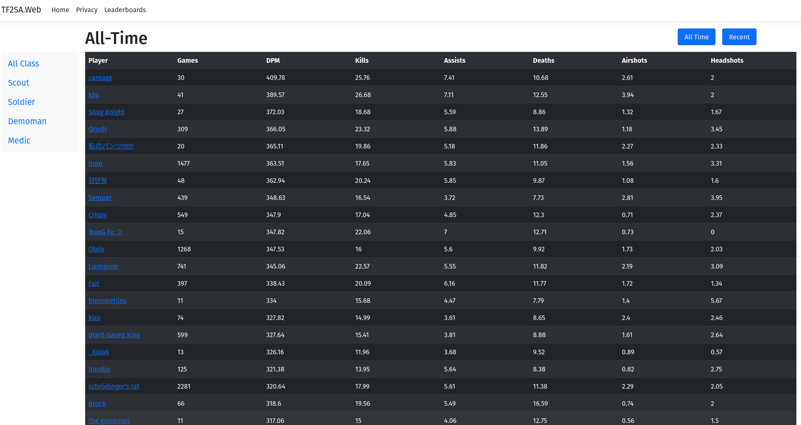
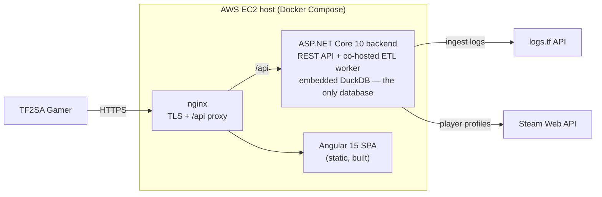

[](https://coveralls.io/github/DeradoZA/tf2sa?branch=main)

# TF2SA

**Player-performance statistics for the South African competitive Team Fortress 2
community.** Live at **[tf2sa.co.za](https://tf2sa.co.za)**.

TF2SA periodically ingests match logs from the public [logs.tf](https://logs.tf)
API for a curated set of SA community uploaders, stores them in an embedded DuckDB
database, aggregates per-class and overall leaderboards on the fly, enriches player
profiles from the Steam Web API, and serves ranked leaderboards through an Angular
single-page app.



## Why it exists

Competitive TF2 games upload rich per-match logs to logs.tf, but that data isn't
aggregated per player, over time, for a specific community. TF2SA curates logs from
the SA community, computes rolling **"recent" (last 365 days)** and **"all-time"**
leaderboards per class (minimum 20 games to qualify), and makes individual and
comparative performance easy to explore.

## High-level architecture

Two data paths that meet only at the database: a background **ingestion (write)
path** and the user-facing **serving (read) path**.



> The ETL ingestion worker runs **inside** the backend process as a
> `BackgroundService`, not as a separate container. See
> [docs/architecture/overview.md](docs/architecture/overview.md) for the full
> picture.

## Technology stack

| Area | Tech |
|------|------|
| Backend | .NET 10 / ASP.NET Core, FluentValidation, `csharp-monad` |
| Database | Embedded **DuckDB** — the only database, both system of record and query engine ([ADR 0008](docs/decisions/0008-duckdb-analytics-read-layer.md), [ADR 0009](docs/decisions/0009-drop-mariadb.md)) |
| Mapping / dispatch | Hand-written extension methods (row ↔ domain ↔ HTTP result); query handlers injected directly via DI, no mediator library |
| Frontend | Angular 15, Angular Material, RxJS |
| External data | logs.tf API, Steam Web API |
| Infra | Docker Compose, nginx, certbot (Let's Encrypt), GitHub Actions, Docker Hub, AWS EC2 |

Full rationale: [docs/architecture/overview.md](docs/architecture/overview.md#technology-stack-and-rationale).

## Repository structure

```
.
├── dotnet/                     # .NET 10 solution (8 projects)
│   ├── TF2SA.Common/           # domain + logs.tf models, errors, constants
│   ├── TF2SA.Http/             # HTTP client, logs.tf + Steam clients
│   ├── TF2SA.Data/             # embedded DuckDB store — schema, reads, writes
│   ├── TF2SA.Query/            # CQRS-lite read side (direct DI dispatch)
│   ├── TF2SA.StatsETLService/  # ingestion pipeline + BackgroundService
│   ├── TF2SA.Web/              # API controllers, Swagger, CORS (deployed entrypoint)
│   ├── TF2SA.Benchmarks/       # BenchmarkDotNet
│   └── TF2SA.Tests.Unit/       # xUnit tests
├── frontend/                   # Angular 15 SPA (atomic-design components)
├── scripts/
│   ├── backup-duckdb.sh        # periodic DuckDB data-file backup
│   └── iac/                    # host bootstrap + nginx config
├── docs/                       # documentation (start at docs/README.md)
├── docker-compose.yml          # 4-container topology
└── .github/workflows/          # CI (build on PR) + CD (deploy on main)
```

## Quick start (local)

Requires Docker + Docker Compose. Create a `.env` next to `docker-compose.yml`:

```dotenv
TF2SA_STEAM_API_KEY=your-steam-web-api-key
```

```bash
docker compose build
docker compose up -d
```

No database to seed — the backend self-initializes an empty DuckDB schema on first
run and fills up from real ingestion. For a tighter dev loop (running the backend
and frontend directly), env-var reference, and how to enable/disable ingestion
locally, see **[docs/onboarding.md](docs/onboarding.md)**.

## Build, test, deploy

```bash
# build
dotnet build dotnet/ /warnaserror
cd frontend && npm run build

# test
dotnet test dotnet/TF2SA.Tests.Unit/TF2SA.Tests.Unit.csproj
cd frontend && npm test
```

CI builds the Docker images on every pull request; CD builds, tests, publishes
images to Docker Hub, and deploys to EC2 on merge to `main`. Details:
[docs/architecture/deployment.md](docs/architecture/deployment.md).

## Configuration

All backend configuration is injected via `TF2SA_`-prefixed environment variables
(DB connection + Steam API key). Ingestion behavior (enable/interval/debug) and the
community uploader allowlist live in `appsettings.json`. See
[docs/onboarding.md](docs/onboarding.md#environment-variables) and
[docs/architecture/ingestion-pipeline.md](docs/architecture/ingestion-pipeline.md#configuration).

## Contributing

Work is issue-driven; branches are named `<issue#>-<slug>`. C# is formatted with
CSharpier, the frontend with Prettier, and CI builds with warnings-as-errors. See
**[CONTRIBUTING.md](CONTRIBUTING.md)** for the full workflow and coding conventions.

## Documentation

Start at **[docs/README.md](docs/README.md)**. Highlights:

- [Architecture overview](docs/architecture/overview.md) — canonical technical reference
- [Ingestion pipeline](docs/architecture/ingestion-pipeline.md) · [Request flow](docs/architecture/request-flow.md) · [Database](docs/architecture/database.md) · [Deployment](docs/architecture/deployment.md)
- [Architecture Decision Records](docs/decisions/) — the *why* behind key choices
- [logs.tf → DB field mapping](docs/stats.md) · [Known issues](docs/known-issues.md)
- AI coding assistants: [AGENTS.md](AGENTS.md)

## License

[GNU GPL v3.0](LICENSE).

## Dad jokes

Every good `DAD-A-BASE` deserves a few:

- What do you call a can opener that's broken? A can't opener.
- Which bear is the most condescending? A PAN-DUH.
- I tried to make a reservation at the library. Unfortunately they're completely booked.
