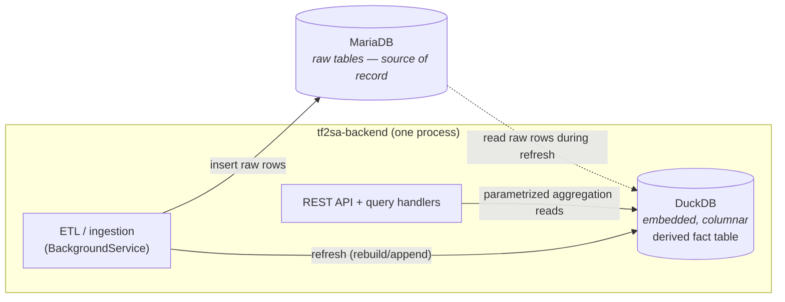

# Analytics Store (DuckDB read layer)

> How TF2SA serves statistics reads. An **embedded DuckDB** columnar store holds a
> derived fact table and answers leaderboard/player queries by aggregating on the
> fly, replacing the pre-computed leaderboard tables and stored procedures. For the
> rationale see [ADR 0008](../decisions/0008-duckdb-analytics-read-layer.md); for the
> raw model that feeds it see [database.md](./database.md); for how a request is
> served see [request-flow.md](./request-flow.md).

## Why this exists

Leaderboards were previously served from 10 pre-aggregated tables rebuilt by 10
stored procedures. That kept reads fast on a large fact set (~1–3M `ClassStats`
rows) but made the system **rigid**: the recent-window (365 days) and the min-games
threshold were baked into SQL, Recent/All-Time were separate tables, and adding a
stat rippled through SQL, procs, entities, repositories, queries, and the frontend.

A row store forces a trade between cheap-but-rigid reads (pre-aggregate) and
flexible-but-slow reads (aggregate live). A **columnar, vectorized** engine removes
the trade: an arbitrary `GROUP BY` over a few million rows is single-digit-to-low
-tens of milliseconds. DuckDB provides that **in-process** — no separate service —
so leaderboards can be computed dynamically per request while staying fast on modest
hardware.

## System-of-record split



- **MariaDB — source of record (unchanged).** Raw tables `Games`, `Players`,
  `PlayerStats`, `ClassStats`, `WeaponStats`; ingestion; foreign keys; the
  processed-log ledger. Row-by-row inserts are what it does well; the write path is
  untouched.
- **DuckDB — derived analytics cache (new).** A single `.duckdb` file (or in-memory,
  rebuilt on startup) holding columnar copies of the raw tables. Because it is fully
  derivable from MariaDB, it is a **rebuildable cache** — it can be regenerated at any
  time, which also means its persistence is not load-bearing (sidestepping the
  `docker-compose down -v` volume concern in [known-issues.md](../known-issues.md)).

> **As implemented, the `(player, game, class)` fact table below is a logical grain,
> not a materialized table.** `RefreshAsync` copies the four raw tables (`Players`,
> `Games`, `PlayerStats`, `ClassStats`) and each macro performs the join itself in a
> CTE. The grain is still the right way to reason about what the views compute — and
> materializing it remains an available optimization (see
> [Phase 0](#phase-0-validation-2026-07-10)) — but no `fact` table exists in the store
> today.

## The fact grain — `(player, game, class)`

One row per `ClassStats` row, pre-joined up through `PlayerStats` → `Games` →
`Players`. This single grain supports **every** current leaderboard and the planned
new views, because the differences between leaderboards are just filters and group
levels over these columns.

| Column | Source | Notes |
|--------|--------|-------|
| `SteamID`, `PlayerName`, `Avatar` | `Players` | identity for display |
| `GameID`, `Date`, `Map` | `Games` | `Date` drives the time-window predicate |
| `Win`, `Loss`, `Draw` | derived | from `PlayerStats.TeamID` + `Games.RedScore/BlueScore` |
| `ClassID` | `ClassStats` | class filter (scout=1, soldier=2, demoman=4, medic=7, sniper=8, spy=9) |
| `Kills`, `Assists`, `Deaths`, `Damage`, `Playtime` | `ClassStats` | per-class per-game |
| `DamageTaken`, `HealsReceived`, `Airshots`, `Ubers`, `Drops`, `MedkitsHP`, `Headshots`, `Backstabs`, `CapturePointsCaptured` | `PlayerStats` | per-game (repeated across a player's class rows in that game) |

A second fact table **`PlayerGameWeaponStats`** (grain `(player, game, class,
weapon)`, from `WeaponStats`) is added when per-weapon views are built; it is not
needed for the current leaderboards.

### Why one grain is enough

The Overall leaderboard's per-class carve-outs are just predicates over `ClassID`:

- **Damage/DPM** excludes medic (`ClassID <> 7`) and sums a player's classes within
  a game before averaging across games (a two-level aggregation — a CTE that groups
  by `(SteamID, GameID)` then averages by `SteamID`).
- **Airshots** counted from projectile classes (`ClassID IN (2,4)`).
- **Headshots** from sniper (`ClassID = 8`); **backstabs** from spy (`ClassID = 9`).

Per-class leaderboards are `WHERE ClassID = :class`; Medic uses its own stat set
(ubers/drops/heals-per-minute). All of it reads from the one fact table.

## Refresh strategy

The refresh runs at the **same trigger point** the stored procs use today — the end
of each ingestion cycle, in `StatisticsUpdater` (see
[ingestion-pipeline.md](./ingestion-pipeline.md)). "Run 10 procs" becomes "refresh
the DuckDB fact table." Two options, decided during the Phase 0 spike:

- **Full rebuild** — `CREATE OR REPLACE TABLE fact AS SELECT … FROM mysql_scan(...)`
  using DuckDB's MySQL scanner. Simplest; matches the current full-rebuild semantics.
- **Incremental append** — insert only rows for the `GameID`s new this cycle (the
  ingestion loop already computes that set). Cheaper as the dataset grows.

Refresh is the **single writer**; API reads are concurrent readers over a consistent
snapshot. A heavy refresh happens once per cycle, not per request.

## Query patterns (replacing the procs)

A leaderboard is one parametrized aggregation. Sketch (DuckDB SQL):

```sql
-- :class, :windowStart, :minGames, :sort, :order, :count, :offset are parameters
SELECT
    SteamID, PlayerName, Avatar,
    COUNT(*)                                   AS NumberOfGames,
    SUM(Win)                                   AS Wins,
    ROUND(SUM(Win) / COUNT(*) * 100, 1)        AS WinPercentage,
    SUM(Draw) AS Draws, SUM(Loss) AS Losses,
    ROUND(AVG(Damage / Playtime * 60), 1)      AS AverageDPM,
    ROUND(AVG(Kills), 1)                       AS AverageKills,
    -- … remaining averages …
    arg_max(GameID, Kills)                     AS TopKillsGameID,
    max(Kills)                                 AS TopKills,
    arg_max(GameID, Damage)                    AS TopDamageGameID,
    max(Damage)                                AS TopDamage
FROM fact
WHERE ClassID = :class
  AND Date > :windowStart          -- Recent vs All-Time is one predicate, not two tables
GROUP BY SteamID, PlayerName, Avatar
HAVING COUNT(*) >= :minGames
ORDER BY :sort :order
LIMIT :count OFFSET :offset;
```

Key differences from the stored procs:

- **Recent vs All-Time** is `:windowStart` (`0` = all-time, `now − 365d` = recent),
  not two tables and two proc files.
- **The threshold** (`HAVING >= 20` / `>= 5`) is `:minGames`.
- **Top-game highlights** use `arg_max(GameID, <stat>)` — no `@rn`/`@prev`
  session-variable ranking, no `LIMIT 9999999` sort. Where a tiebreak beyond the max
  is required, `ROW_NUMBER() OVER (PARTITION BY SteamID ORDER BY …)` is available.

## Read-path integration

The CQRS structure is preserved ([ADR 0003](../decisions/0003-cqrs-read-side-with-mediatr.md)):
controllers, MediatR queries/handlers, result models, and the JSON contract are
unchanged, so **the frontend and the existing leaderboard endpoints do not change**.
Only the data access is swapped:

- A new **DuckDB-backed stats repository** builds the parametrized SQL above,
  replacing the EF-Core-over-pre-agg-tables repositories in
  `TF2SA.Data/Repositories/MariaDb/Statistics/`.
- The **sort/filter whitelist is preserved** — request keys map to a fixed set of
  column names (as `PropertyKeySelectors` does today in `StatsRepository.cs`); raw
  input is never interpolated into SQL. `period` and `minGames` become
  handler/controller parameters with the current defaults.

## Views this unlocks

Beyond the leaderboards, the same tables support (built incrementally):

- **Player detail — built.** `player_summary(steamid)` and
  `player_class_splits(steamid)` in
  [`TF2SA.Data/Analytics/PlayerDetail.sql`](../../dotnet/TF2SA.Data/Analytics/PlayerDetail.sql),
  served by `GET v1/Players/{steamId}/Detail`. See
  [Per-player views](#per-player-views-player-detail--progression) below.
- **Progression over time — built.** `players_progression_overall(steamids,
  bucketpart, recentonly)` and `players_progression_class(steamids, bucketpart,
  classid, recentonly)`, bucketed by week or month, in the same file. Both take a
  **list** of SteamIDs, so the same macro serves the single-player endpoint and the
  multi-player `GET v1/Players/Compare` used by the leaderboard graph views.
- **Per-map** — `GROUP BY Map` for map-specific leaderboards/splits. `Games.Map` is
  already copied into DuckDB, so this needs no refresh change.
- **Per-weapon** — needs a `PlayerGameWeaponStats` fact table **and** `WeaponStats`
  added to the store's `RawTables` (it is not copied from MariaDB today).

## Per-player views (player detail + progression)

[`PlayerDetail.sql`](../../dotnet/TF2SA.Data/Analytics/PlayerDetail.sql) is a second
embedded SQL file, loaded alongside `Leaderboards.sql`, holding four macros
parametrized by SteamID. One MediatR query (`GetPlayerDetail`) calls summary,
progression and class splits together, so the page loads in one request and the
frontend's stat selector re-renders from data it already has.

- **Airshots is a per-game field, not per-class.** `players_progression_class`
  therefore returns `NULL` for classes that cannot airshot, rather than attributing
  a projectile class's airshots to the scout row of a player who swapped mid-game.
- **Career averages come from `player_summary`, not from the buckets.** Re-deriving
  them client-side by weighting bucket averages on game count disagrees with the true
  figure: a bucket's count includes medic games whose damage is absent from its
  average, and each bucket is already rounded.

- **DPM is defined identically to `overall_board`** (per-game sum over non-medic
  classes, then averaged across games), so a player's headline DPM matches their
  leaderboard row exactly.
- **These views carry no parity obligation**, so unlike the class/medic boards they use
  real `AVG(Assists)` rather than replicating the stored procs' `AVG(Kills)` bug.
- **`player_summary` ends in `HAVING COUNT(...) > 0`** so an unknown SteamID yields
  zero rows rather than a single all-NULL row (a bare aggregate always returns one),
  which is what lets the handler distinguish "no such player" and return a null summary.
- **The bucket parameter is named `bucketpart`, not `bucket`** — a macro parameter
  shadows a column alias case-insensitively, so `bucket` would break `ORDER BY Bucket`.
- **Bucketing is pinned to UTC** (`to_timestamp(g.Date) AT TIME ZONE 'UTC'`), which
  also yields a naive `TIMESTAMP`; without it bucket boundaries move with the server's
  local timezone.
- Reads go through `IAnalyticsStore.GetAllAsync`/`GetSingleAsync` — whole-view reads
  with no paging/sort/filter, as opposed to `GetPageAsync`'s leaderboard shape. The
  SteamID is bound as a `ulong` at the controller, so it cannot carry SQL; the bucket
  is whitelisted to `week`/`month` in the handler.

### View definitions are reloaded on connection open

Macros are installed by `RefreshAsync`, but a refresh only runs when an ingestion cycle
finds **new logs** — so after deploying changed SQL to a store that already has data,
the macros would otherwise stay stale indefinitely. `DuckDbAnalyticsStore.Connection()`
therefore reloads both SQL files on first use, guarded by a check that the raw tables
exist (DuckDB resolves table references when a macro is *created*, so macros cannot be
installed against an empty file — a fresh file is handled by the refresh, which loads
them itself).

## Consistency & hardware

- **Eventual consistency**, refreshed once per ingestion cycle — identical freshness
  to the tables it replaces; transactional accuracy is explicitly not required here.
- **In-process, small footprint.** DuckDB is memory-managed and spills to disk; a
  1–3M-row columnar fact table is on the order of tens of MB. No extra container; no
  change to `docker-compose.yml`.

## Phase 0 validation (2026-07-10)

A throwaway spike (`DuckDB.NET.Data.Full` 1.5.3, in-process, on synthetic fact
tables at the real grain) confirmed the approach and surfaced one constraint:

- **Native load works** on linux-x64 — the package bundles `libduckdb.so`; no manual
  native setup. The **MySQL scanner extension** (`INSTALL mysql; LOAD mysql;`) and a
  **file-backed store** (write → close → reopen) both round-trip, so the refresh
  source and the rebuildable-cache pattern are both viable.
- **Latency** (median, over 1–3M rows), pinned to **2 threads + 1 GB** to emulate a
  small ~2 vCPU EC2:

  | Query | 1M rows | 2M rows | 3M rows |
  |-------|--------:|--------:|--------:|
  | Per-class leaderboard (Scout, recent) | ~3 ms | ~6 ms | ~9 ms |
  | Overall (all-time, two-level per-game→per-player) | ~136 ms | ~282 ms | ~470 ms |

  Per-class boards are effectively free. The **Overall** board is the cost driver
  because it aggregates every row twice (per-game across classes, then per-player);
  at the top of the volume range on a 2-vCPU box it is ~0.5 s per request. On all 20
  cores of the dev box the same query is ~140 ms. **Mitigation if needed:**
  materialize the per-game (or per-player Overall) rollup **inside DuckDB at refresh
  time** — a small, cheap pre-aggregation that keeps the flexible columnar model while
  making the Overall read as fast as the per-class ones; or add a short-TTL result
  cache. This is a far lighter footprint than the 10 MariaDB tables + 10 procs it
  replaces.
- **Runtime prerequisite — satisfied.** DuckDB.NET 1.5.x ships only `net8.0` /
  `net10.0` assemblies (no `net7.0`). This blocked adoption while the backend was on
  `net7.0`; the backend has since been upgraded to **.NET 10**
  ([known-issues.md](../known-issues.md)), so the prerequisite is now met.

## Phase 1 validation — math parity (2026-07-10)

The DuckDB aggregation queries were proven to reproduce the stored procs **exactly**.
MariaDB 10.6 ran the real schema + all 10 procs on a deterministic generated dataset
(250 players / 1500 games / 22.5k class rows); DuckDB attached MariaDB via the
`mysql` scanner and diffed each ported board against its proc table by normalized
per-row signature.

- **All 10 boards passed** — same row set and same value in every column: counts,
  win/loss/draw, per-minute normalization (float division), thresholds, the
  365-day window, the Overall class carve-outs, and the top-game tiebreaks.
- The ports faithfully replicate the class/medic **`AverageAssists = AVG(Kills)`**
  copy-paste bug (a negative control that "fixes" it produced 42 mismatches,
  confirming the harness detects real differences). The migration is the natural
  point to fix the bug — a one-line change per board.
- The verified queries live in
  [`TF2SA.Data/Analytics/Leaderboards.sql`](../../dotnet/TF2SA.Data/Analytics/Leaderboards.sql)
  (embedded into the assembly) as the reference the Phase 2 read repository will embed.

## Implementation — store + refresh (2026-07-11)

`TF2SA.Data/Analytics/DuckDbAnalyticsStore.cs` (behind `IAnalyticsStore`) implements
the store. `RefreshAsync` opens the DuckDB file, `ATTACH`es MariaDB via the `mysql`
scanner, `CREATE OR REPLACE`s the four raw tables (`Players`, `Games`, `PlayerStats`,
`ClassStats`) as a full rebuild, detaches, and loads the embedded leaderboard macros.
It is registered as a singleton and invoked from `StatisticsUpdater` **alongside the
stored procs** (the Phase 1 parallel run) — non-fatal: a refresh failure is logged
but does not fail the ingestion cycle. Verified end-to-end against a live MariaDB:
the real store refreshes and every board returns the same player set and row count as
its proc.

**mysql is used only at refresh.** The read path queries local DuckDB tables only —
it never attaches MariaDB — so read queries don't depend on the `mysql` extension.
(A heavy diagnostic query that simultaneously scanned mysql-attached tables tripped a
native libduckdb crash in the parity harness; the product read path avoids that shape
entirely.)

### Read path (Phase 2, 2026-07-11)

`IAnalyticsStore.GetPageAsync<T>` serves a paged board read: it wraps a board macro
(e.g. `class_board(1,5,1)`) with a **whitelisted** sort, an optional player-name
`ILIKE` filter, and `LIMIT`/`OFFSET`, then maps rows onto the EF stat entity `T` by
case-insensitive column name (DuckDB identifiers are case-insensitive, so the entity
property names resolve to the board columns; only real properties are sortable/
filterable — the injection guard). The 10 MediatR query handlers now branch on
`IAnalyticsStore.Enabled`: **when analytics is enabled they read from DuckDB; when
disabled they keep the EF-over-pre-agg-tables path** (the parallel run — Phase 3
removes the EF branch, the pre-agg tables, and the procs). The HTTP/JSON contract is
unchanged either way. A single DuckDB connection is shared and access is serialized
with a semaphore (single writer at refresh, fast reads), which suits this scale;
connection pooling is a later optimization if read concurrency demands it.

**Phase 2 validation.** Driving the real store against a live MariaDB: for every one
of the 10 boards, `GetPageAsync` (top-13 by the board's default sort) returned the
same player set and the same descending stat sequence as the corresponding MariaDB
pre-agg table (what the EF path serves), with matching totals; the player-name filter
and paging (disjoint pages) behaved correctly. Full solution builds under
`/warnaserror` with the read path in place and all unit tests pass.

### Configuration

| Env var | Default | Meaning |
|---------|---------|---------|
| `TF2SA_ANALYTICS_ENABLED` | `false` | Master switch; when off, `RefreshAsync` is a no-op. |
| `TF2SA_DUCKDB_PATH` | temp dir | Path to the `.duckdb` cache file (a rebuildable derived cache; a writable volume in prod). |
| `TF2SA_MYSQL_PORT` | `3306` | MariaDB port for the scanner; host/user/password/db reuse the existing `TF2SA_MYSQL_*` vars. |

> **Deployment note:** the first refresh runs `INSTALL mysql` which downloads the
> extension from `extensions.duckdb.org`; the host needs outbound access (or the
> extension pre-installed). The `.duckdb` file is a derived cache and can be rebuilt
> from MariaDB at any time.

## Risks

- **Refresh vs. read concurrency** — one writer per cycle, snapshot reads; the swap
  approach (e.g. rebuild-then-swap, or a write transaction) is settled during
  implementation.
- **Math parity** — the DuckDB aggregations must match the retired procs exactly
  (win/loss/draw, per-minute normalization, thresholds, Overall class carve-outs);
  enforced by a dual-run output diff during migration.
- **Overall-board latency at peak volume** — see Phase 0; materialize a per-game
  rollup or cache if it proves too slow on the production box.

## When to update this document

Update this document when:

- The fact grain or columns change, or a fact table is actually materialized.
- The set of raw tables copied by the refresh changes (e.g. adding `WeaponStats` for
  per-weapon views).
- The refresh trigger, cadence, or full-rebuild-vs-incremental choice changes.
- The query/parameter model for leaderboards changes (new window semantics,
  thresholds, sort/filter surface).
- A new analytical view is added, or a new embedded `.sql` file is loaded by the store.
- The read layer moves off DuckDB (which would
  supersede [ADR 0008](../decisions/0008-duckdb-analytics-read-layer.md)).
