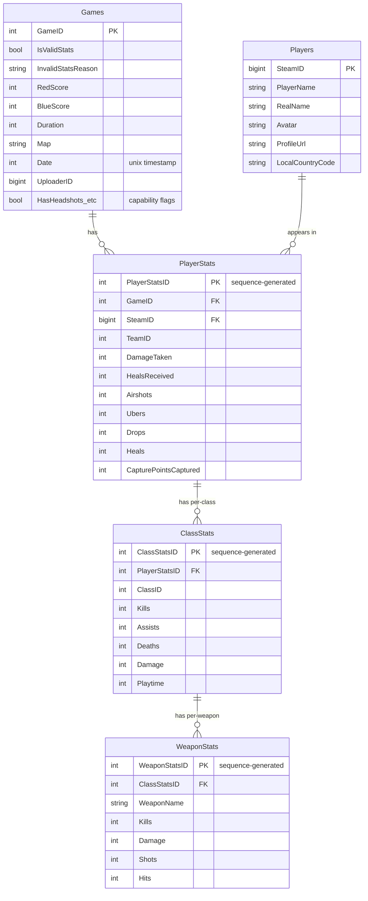

# Database

> The data model — how it is defined and evolved — held in an embedded **DuckDB**
> database, which is the **system of record**. There is no separate database
> service: DuckDB runs in-process inside `tf2sa-backend`
> ([ADR 0008](../decisions/0008-duckdb-analytics-read-layer.md),
> [ADR 0009](../decisions/0009-drop-mariadb.md)). Both the
> [write path](./ingestion-pipeline.md) and the [read path](./request-flow.md) go
> through the same tables — a write is immediately visible to every read.

## Engine and conventions

- **DuckDB**, file-backed (`TF2SA_DUCKDB_PATH`, a host bind mount in production —
  see [deployment.md](./deployment.md)).
- Schema lives in
  [`TF2SA.Data/Analytics/Schema.sql`](../../dotnet/TF2SA.Data/Analytics/Schema.sql),
  embedded into the assembly and applied idempotently (`CREATE TABLE IF NOT EXISTS`,
  `CREATE SEQUENCE IF NOT EXISTS`) on every connection open — a fresh file
  self-initializes; an existing one is a no-op. There is no scaffolding tool and no
  migration history: **the SQL file is the schema**, hand-maintained directly.
- Column names and types mirror what the schema held under MariaDB, so the
  leaderboard/player-detail macros in
  [`Leaderboards.sql`](../../dotnet/TF2SA.Data/Analytics/Leaderboards.sql) and
  [`PlayerDetail.sql`](../../dotnet/TF2SA.Data/Analytics/PlayerDetail.sql) needed no
  changes when the database moved.

## What DuckDB holds

The **raw, per-match tables** are the source of record; the same tables are what
every leaderboard/player-detail macro aggregates on the fly:

| Tables | Written by | Read by |
|--------|-----------|---------|
| `Games`, `Players`, `PlayerStats`, `ClassStats`, `WeaponStats` | Ingestion pipeline, directly (`IAnalyticsStore.InsertGameAsync`/`UpsertPlayersAsync`/`UpdatePlayersAsync`) | Every leaderboard/player-detail/comparison/player-list query, in the same process, no refresh step in between |

> **Historical note.** Two things used to sit between "ingested" and "queryable"
> here and are both gone now: a second tier of 12 **pre-aggregated** leaderboard
> tables rebuilt by 10 MariaDB stored procedures (retired — see
> [ADR 0008](../decisions/0008-duckdb-analytics-read-layer.md)), and MariaDB itself
> as a separate database that DuckDB copied from once per ingestion cycle (retired —
> see [ADR 0009](../decisions/0009-drop-mariadb.md)). The API aggregates per request
> directly over these five tables; there is nothing precomputed and nothing to copy.

## Raw schema (entity-relationship)

Foreign keys are declared (`REFERENCES` in `Schema.sql`) and enforced by DuckDB, so
an insert referencing a missing parent row fails rather than landing an orphan.
`GameID` and `SteamID` are always caller-supplied (from logs.tf / Steam data), never
generated. The three per-row-in-a-game surrogate keys
(`PlayerStatsID`/`ClassStatsID`/`WeaponStatsID`) have no native "auto-increment" in
DuckDB — they're assigned from DuckDB sequences (`seq_playerstats` etc.), fetched
explicitly and threaded down through the insert graph by
`DuckDbAnalyticsStore.InsertGameAsync` and its row-insert helpers. The pre-rendered
ERD image [`docs/erd.png`](../erd.png) predates this and describes the shape only,
not the current storage engine.

### What each raw table holds

- **`Games`** — one row per ingested log, keyed by the logs.tf `GameID`. Carries
  scores, map, duration, date, uploader, and a set of `Has*` capability flags
  describing which stats that log includes. Also acts as the **processed-log
  ledger**: logs that fail validation are stored here with `IsValidStats = false`
  and an `InvalidStatsReason`, so they are recorded and never re-fetched.
- **`Players`** — one row per Steam player, keyed by `SteamID`; profile fields are
  enriched from the Steam Web API during ingestion.
- **`PlayerStats`** — one row per player per game (their whole-match stats).
- **`ClassStats`** — one row per player per game per class played (`ClassID` maps to
  the `ClassId` enum: scout=1, soldier=2, demoman=4, medic=7, …). Per-class kills,
  assists, deaths, damage, playtime.
- **`WeaponStats`** — one row per weapon within a `ClassStats` row. Ingested but not
  yet read by any query — see [known-issues.md](../known-issues.md).

> **Data provenance:** [`docs/stats.md`](../stats.md) is the authoritative,
> field-by-field mapping from the logs.tf JSON response to these columns, including
> which fields are intentionally dropped and why. Consult it before adding or
> changing an ingested field.

## Aggregation lives in the same store

Per-player leaderboards (per-class and overall, "recent" vs "all-time", the
min-games threshold, win/loss/draw, averages, and "top game" highlights), player
detail, and comparison are all **computed on the fly** from these five tables by
parametrized DuckDB macros. The "recent" window and the games threshold are **query
parameters**, not schema. See [analytics-store.md](./analytics-store.md) for the
macros, the write path, and the query patterns.

## How to change the schema

There is no scaffolding step and no ORM to keep in sync — the workflow is:

1. Edit `TF2SA.Data/Analytics/Schema.sql` directly (add a column, a table, a
   sequence).
2. Update the row POCOs in `TF2SA.Data/Analytics/Rows/` (or the `*Write` types) that
   the change affects — these are hand-written, not generated, and map to columns by
   case-insensitive name.
3. Update the write path (`DuckDbAnalyticsStore.InsertGameAsync` and its row-insert
   helpers, or `LogIngestionRepositoryUpdater`'s `GameLog` → `GameWrite` mapping) if
   the change affects ingestion.
4. Update [`docs/stats.md`](../stats.md) if ingested fields changed, and any
   leaderboard/player-detail macro in [analytics-store.md](./analytics-store.md)
   that should surface the new column.

A schema change to an **existing production deployment** also needs the one-time
migration step described in [deployment.md](./deployment.md) if it changes column
types or adds a `NOT NULL` column without a default — `CREATE TABLE IF NOT EXISTS`
only helps a table that doesn't exist yet; it does not alter one that does.

## When to update this document

Update this document when:

- A raw table, column, key, or foreign-key relationship is added/removed/changed.
- The DB engine or version changes.

Aggregation concerns — the recent-window length, the min-games threshold, stat
definitions, and the macro shapes — now live in
[analytics-store.md](./analytics-store.md); update that document instead.
