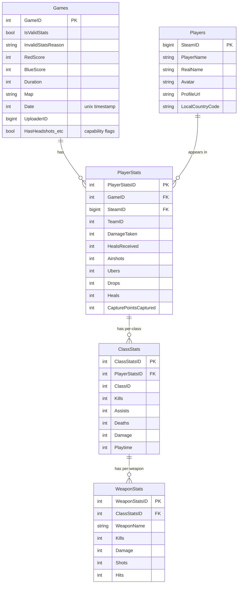

# Database

> The data model, how it is defined and evolved, and how aggregated leaderboards
> are produced. The database is the meeting point of the
> [write path](./ingestion-pipeline.md) and the [read path](./request-flow.md).

## Engine and conventions

- **MariaDB 10.6**, InnoDB, `utf8mb4` / `utf8mb4_unicode_ci` (player names contain
  non-ASCII characters).
- Schema and stored procedures live in [`scripts/mariadb/`](../../scripts/mariadb/)
  and are applied at container startup: `Dockerfile.tf2sa-db` copies every `.sql`
  file into `/docker-entrypoint-initdb.d/`, which MariaDB runs on first
  initialization (`create_stats_schema.sql` creates tables; each
  `update_*_stats.sql` defines one stored procedure).
- **The SQL schema is the source of truth** for the data model. C# entities are
  reverse-engineered from it — see [ADR 0004](../decisions/0004-database-first-ef-scaffolding.md).

## Two tiers of tables

| Tier | Tables | Written by | Read by |
|------|--------|-----------|---------|
| **Raw** (per match) | `Games`, `Players`, `PlayerStats`, `ClassStats`, `WeaponStats` | Ingestion pipeline (row-by-row inserts) | Aggregation stored procs |
| **Aggregated** (per player, pre-computed) | `{Scout,Soldier,Demoman,Medic}{Recent,AllTime}`, `OverallStats{Recent,AllTime}` | Aggregation stored procs (`DELETE` + `INSERT`) | The API read path |

The API never aggregates on the fly — it reads the pre-computed aggregated tables.

## Raw schema (entity-relationship)



Foreign keys cascade on delete/update (`fk_game_id`, `fk_player_id`,
`fk_playerstats_id`, `fk_class_stats`), so removing a `Game` cleans up its child
rows. The pre-rendered ERD image [`docs/erd.png`](../erd.png) is a companion view.

### What each raw table holds

- **`Games`** — one row per ingested log, keyed by the logs.tf `GameID`. Carries
  scores, map, duration, date, uploader, and a set of `Has*` capability flags
  describing which stats that log includes. Also acts as the **processed-log
  ledger**: logs that fail validation are stored here with `IsValidStats = false`
  and an `InvalidStatsReason`, so they are recorded and never re-fetched.
- **`Players`** — one row per Steam player, keyed by `SteamID`; profile fields are
  enriched from the Steam Web API during ingestion.
- **`PlayerStats`** — one row per player per game (their whole-match stats).
- **`ClassStats`** — one row per player per game per class played (`ClassID` maps to
  the `ClassId` enum: scout=1, soldier=2, demoman=4, medic=7, …). Per-class kills,
  assists, deaths, damage, playtime.
- **`WeaponStats`** — one row per weapon within a `ClassStats` row.

> **Data provenance:** [`docs/stats.md`](../stats.md) is the authoritative,
> field-by-field mapping from the logs.tf JSON response to these columns, including
> which fields are intentionally dropped and why. Consult it before adding or
> changing an ingested field.

## Aggregated tables and the "recent vs all-time" model

For each of Scout, Soldier, Demoman, Medic, and Overall there are **two** tables:

- **`*AllTime`** — aggregates over *all* qualifying games.
- **`*Recent`** — identical shape, but restricted to games from the **last 365
  days** (`WHERE g.Date > UNIX_TIMESTAMP() - 365*24*60*60`).

Each aggregated row is keyed by `SteamID` and holds pre-computed averages (DPM,
kills, deaths, heals, etc.), win/loss/draw counts, win percentage, and "top game"
highlights (e.g. `TopDamage` + `TopDamageGameID`). Only players with **at least 20
qualifying games** appear (`HAVING NumberOfGames >= 20`).

Class membership is decided by `ClassStats.ClassID` (e.g. Scout procs filter
`cs.ClassID = 1`); the Overall tables aggregate across classes.

## Stored procedures (aggregation)

Ten procedures, one per aggregated table, in `scripts/mariadb/update_*_stats.sql`:

```
update_scout_recent_stats.sql      → UpdateScoutRecentStats()
update_scout_alltime_stats.sql     → UpdateScoutAllTimeStats()
update_soldier_recent_stats.sql    → UpdateSoldierRecentStats()
update_soldier_alltime_stats.sql   → UpdateSoldierAllTimeStats()
update_demoman_recent_stats.sql    → UpdateDemomanRecentStats()
update_demoman_alltime_stats.sql   → UpdateDemomanAllTimeStats()
update_medic_recent_stats.sql      → UpdateMedicRecentStats()
update_medic_alltime_stats.sql     → UpdateMedicAllTimeStats()
update_overall_recent_stats.sql    → UpdateOverallRecentStats()
update_overall_alltime_stats.sql   → UpdateOverallAllTimeStats()
```

Each procedure `DELETE`s its target table then re-`INSERT`s a freshly computed
result set (a CTE joins `ClassStats`/`PlayerStats`/`Players`/`Games`, plus
window-style CTEs to find each player's top games). They are invoked from C# via
`StatsRepository<TEntity>.CallUpdateStoredProc()` →
`DbContext.Database.ExecuteSqlRawAsync(...)`, orchestrated by `StatisticsUpdater`
at the end of each ingestion cycle.

> **Maintenance note:** the "top game" CTEs use MariaDB session-variable ranking
> (`@rn`/`@prev`) rather than window functions. This is terse and version-sensitive;
> see [known-issues.md](../known-issues.md). If you change stat definitions,
> remember that recent and all-time are **separate files** that must be kept in
> sync.

## How to change the schema (the scaffold workflow)

Because the model is database-first, the workflow is:

1. Edit the SQL in `scripts/mariadb/` (schema and/or the relevant procedures).
2. Apply it to your database (re-init the DB container, or run the SQL manually).
3. Re-generate the EF Core entities and `DbContext` by running
   `TF2SA.Data/scaffold.sh` (uses `dotnet ef dbcontext scaffold` against the live
   DB, `--force`, restricted to the listed tables).
4. Update `TF2SADbContext` registrations / repositories / mappings as needed for
   new entities.
5. Update [`docs/stats.md`](../stats.md) if ingested fields changed.

**Do not hand-edit the scaffolded entities or the generated parts of
`TF2SADbContext`** — `scaffold.sh --force` overwrites them.

## When to update this document

Update this document when:

- A table, column, key, or foreign-key relationship is added/removed/changed.
- The recent-window definition (365 days) or the minimum-games threshold (20)
  changes.
- A stored procedure is added/removed, or aggregation logic changes materially.
- The scaffold workflow or the set of scaffolded tables changes.
- The DB engine or version changes.
