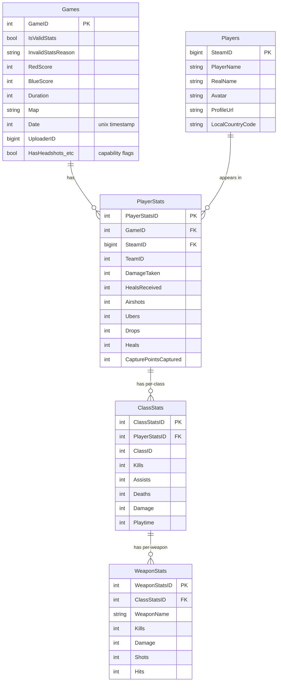

# Database

> The **raw data model** — how it is defined and evolved — held in MariaDB, which is
> the **system of record**. Leaderboard aggregation no longer lives here: it moved to
> an embedded **DuckDB analytics read layer** ([ADR 0008](../decisions/0008-duckdb-analytics-read-layer.md),
> [analytics-store.md](./analytics-store.md)). This database is where the
> [write path](./ingestion-pipeline.md) lands raw rows; the [read path](./request-flow.md)
> now serves from DuckDB.

## Engine and conventions

- **MariaDB 10.6**, InnoDB, `utf8mb4` / `utf8mb4_unicode_ci` (player names contain
  non-ASCII characters).
- Schema and stored procedures live in [`scripts/mariadb/`](../../scripts/mariadb/)
  and are applied at container startup: `Dockerfile.tf2sa-db` copies every `.sql`
  file into `/docker-entrypoint-initdb.d/`, which MariaDB runs on first
  initialization (`create_stats_schema.sql` creates tables; each
  `update_*_stats.sql` defines one stored procedure).
- **The SQL schema is the source of truth** for the data model. C# entities are
  reverse-engineered from it — see [ADR 0004](../decisions/0004-database-first-ef-scaffolding.md).

## What MariaDB holds

MariaDB holds the **raw, per-match tables only** — the source of record:

| Tables | Written by | Read by |
|--------|-----------|---------|
| `Games`, `Players`, `PlayerStats`, `ClassStats`, `WeaponStats` | Ingestion pipeline (row-by-row inserts) | The DuckDB refresh (which derives the analytics fact table from these) |

> **Historical note.** MariaDB previously also held a second tier of 12
> **pre-aggregated** leaderboard tables (`{Scout,Soldier,Demoman,Medic}{Recent,AllTime}`,
> `OverallStats{Recent,AllTime}`) rebuilt by 10 stored procedures. Those are being
> retired in favour of on-the-fly aggregation in DuckDB — see
> [analytics-store.md](./analytics-store.md) and
> [ADR 0008](../decisions/0008-duckdb-analytics-read-layer.md). The API now aggregates
> per request in the columnar read layer; it no longer reads pre-computed tables here.

## Raw schema (entity-relationship)

Foreign keys cascade on delete/update (`fk_game_id`, `fk_player_id`,
`fk_playerstats_id`, `fk_class_stats`), so removing a `Game` cleans up its child
rows. The pre-rendered ERD image [`docs/erd.png`](../erd.png) is a companion view.

### What each raw table holds

- **`Games`** — one row per ingested log, keyed by the logs.tf `GameID`. Carries
  scores, map, duration, date, uploader, and a set of `Has*` capability flags
  describing which stats that log includes. Also acts as the **processed-log
  ledger**: logs that fail validation are stored here with `IsValidStats = false`
  and an `InvalidStatsReason`, so they are recorded and never re-fetched.
- **`Players`** — one row per Steam player, keyed by `SteamID`; profile fields are
  enriched from the Steam Web API during ingestion.
- **`PlayerStats`** — one row per player per game (their whole-match stats).
- **`ClassStats`** — one row per player per game per class played (`ClassID` maps to
  the `ClassId` enum: scout=1, soldier=2, demoman=4, medic=7, …). Per-class kills,
  assists, deaths, damage, playtime.
- **`WeaponStats`** — one row per weapon within a `ClassStats` row.

> **Data provenance:** [`docs/stats.md`](../stats.md) is the authoritative,
> field-by-field mapping from the logs.tf JSON response to these columns, including
> which fields are intentionally dropped and why. Consult it before adding or
> changing an ingested field.

## Aggregation lives in the analytics store

Per-player leaderboards (per-class and overall, "recent" vs "all-time", the
min-games threshold, win/loss/draw, averages, and "top game" highlights) are
**computed on the fly in the DuckDB analytics read layer**, from a derived fact
table built out of these raw tables. The "recent" window and the games threshold are
**query parameters** there, not schema. See
[analytics-store.md](./analytics-store.md) for the fact-table grain, the refresh
strategy, and the query patterns.

The 10 pre-aggregated tables and the 10 `scripts/mariadb/update_*_stats.sql` stored
procedures that formerly produced them are being removed as part of that migration
([ADR 0008](../decisions/0008-duckdb-analytics-read-layer.md)).

## How to change the schema (the scaffold workflow)

The **raw** tables remain database-first. The workflow is:

1. Edit the schema SQL in `scripts/mariadb/create_stats_schema.sql`.
2. Apply it to your database (re-init the DB container, or run the SQL manually).
3. Re-generate the EF Core entities and `DbContext` by running
   `TF2SA.Data/scaffold.sh` (uses `dotnet ef dbcontext scaffold` against the live
   DB, `--force`, restricted to the listed **raw** tables).
4. Update `TF2SADbContext` registrations / repositories / mappings as needed for
   new entities.
5. Update [`docs/stats.md`](../stats.md) if ingested fields changed, and refresh the
   DuckDB fact-table projection in [analytics-store.md](./analytics-store.md) if a
   new raw column should surface in leaderboards.

> The analytics read layer is **not** part of this scaffold workflow — it queries the
> raw tables directly via DuckDB and has no scaffolded EF entities. Changing a
> leaderboard means editing a query, not the schema (see
> [analytics-store.md](./analytics-store.md)).

**Do not hand-edit the scaffolded entities or the generated parts of
`TF2SADbContext`** — `scaffold.sh --force` overwrites them.

## When to update this document

Update this document when:

- A raw table, column, key, or foreign-key relationship is added/removed/changed.
- The scaffold workflow or the set of scaffolded (raw) tables changes.
- The DB engine or version changes.

Aggregation concerns — the recent-window length, the min-games threshold, stat
definitions, and the fact-table shape — now live in
[analytics-store.md](./analytics-store.md); update that document instead.
