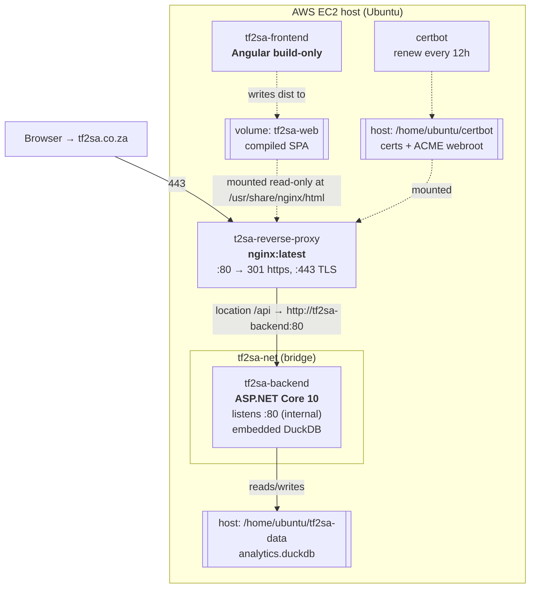
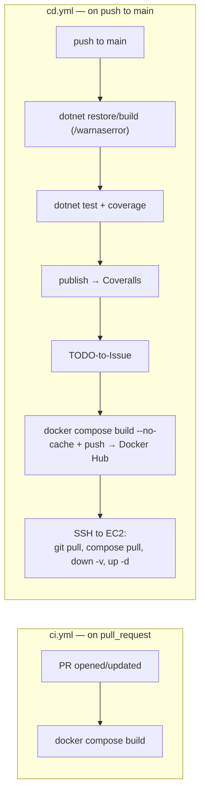

# Deployment

> How TF2SA is packaged, delivered, and run in production. For the container
> responsibilities see [overview.md](./overview.md).

## Runtime topology

Production runs on a single **AWS EC2** host (Ubuntu) as four containers defined in
[`docker-compose.yml`](../../docker-compose.yml), on a shared `tf2sa-net` bridge
network. The Angular build container and nginx communicate through a shared Docker
volume (`tf2sa-web`) rather than the network. There is no separate database
container — DuckDB is embedded in `tf2sa-backend`
([ADR 0009](../decisions/0009-drop-mariadb.md)) and its data file lives on a host
bind mount.



### Container roles

| Container | Image | Ports | Notes |
|-----------|-------|-------|-------|
| `tf2sa-backend` | `danielcoetzee/tf2sa-backend` (`dotnet/Dockerfile.tf2sa-backend`) | internal :80 | Publishes `TF2SA.Web`; runs API + co-hosted ETL + embedded DuckDB, the only database. Data file bind-mounted at `/data`. |
| `tf2sa-frontend` | `danielcoetzee/tf2sa-frontend` (`frontend/Dockerfile.tf2sa-frontend`) | none | **Build-only** — compiles the SPA into `/out` and exits; nginx serves the volume. |
| `t2sa-reverse-proxy` | `nginx:latest` | `80`, `443` | TLS termination, static SPA, `/api` proxy. Periodically reloads for renewed certs. |
| `certbot` | `certbot/certbot:latest` | none | Renews Let's Encrypt certs on a 12h loop. |

> **Frontend is compile-then-exit.** `tf2sa-frontend` is not a running web server;
> it exists only to produce static assets into the shared `tf2sa-web` volume, which
> nginx mounts read-only. Rebuilding the frontend means rebuilding this container so
> fresh assets land in the volume.

## nginx and TLS

[`scripts/iac/nginx/nginx.conf`](../../scripts/iac/nginx/nginx.conf):

- Port 80 serves the ACME challenge (`/.well-known/acme-challenge/`) and otherwise
  `301`-redirects to `https://tf2sa.co.za`.
- Port 443 terminates TLS (certs under `/etc/nginx/ssl/live/tf2sa.co.za/`), serves
  the SPA with SPA fallback (`try_files $uri $uri/ /index.html`), and proxies
  `location /api` to `http://tf2sa-backend:80`.

The backend trusts forwarding headers (`app.UseForwardedHeaders(...)` for
`X-Forwarded-For`/`X-Forwarded-Proto`) because it sits behind this proxy.

## Configuration and secrets

All runtime configuration is injected as environment variables (see
[onboarding.md](../onboarding.md#environment-variables) for the full list and local
setup). In CI/CD these come from GitHub Actions secrets.

| Variable | Purpose |
|----------|---------|
| `TF2SA_DUCKDB_PATH` | Path to the DuckDB data file — the only database. `/data/analytics.duckdb` in production (bind-mounted); a temp-dir default locally if unset. |
| `TF2SA_STEAM_API_KEY` | Steam Web API key for player enrichment. |

The frontend's API base URL is compiled in, not env-injected:
`frontend/src/environments/environment.ts` (`https://tf2sa.co.za/api/v1`) for
production, `environment.development.ts` (`https://localhost:5001/api/v1`) for dev.

## CI/CD pipelines (GitHub Actions)

Two workflows in `.github/workflows/`:



- **CI** (`ci.yml`) runs on every pull request and only verifies that the Docker
  images build.
- **CD** (`cd.yml`) runs on push to `main`: it builds and unit-tests the .NET
  solution (failing on warnings), publishes coverage to Coveralls, converts new
  `TODO` comments to GitHub issues, builds and pushes the three images to Docker
  Hub, then SSHes into the EC2 host and redeploys with `docker-compose pull` +
  `down -v` + `up -d`.

> **`down -v` drops volumes on each deploy.** This no longer risks the database:
> since [ADR 0009](../decisions/0009-drop-mariadb.md), DuckDB's data file lives on a
> **host bind mount** (`/home/ubuntu/tf2sa-data` → `/data`), not a compose-managed
> volume, and `down -v` only removes what's declared in `docker-compose.yml`'s
> top-level `volumes:` block (currently just `tf2sa-web`, the compiled SPA — cheap to
> rebuild). See [scripts/backup-duckdb.sh](../../scripts/backup-duckdb.sh) for
> periodic backup of the data file itself, which is now load-bearing rather than a
> rebuildable cache.

## Host provisioning

`scripts/iac/iac.sh` is a minimal bootstrap that installs Docker and
docker-compose on a fresh Ubuntu host. TLS material lives under
`/home/ubuntu/certbot` on the host and is bind-mounted into nginx and certbot;
DuckDB's data file lives under `/home/ubuntu/tf2sa-data` the same way. Neither
directory needs pre-creation — Docker creates an empty one on first bind mount, and
`tf2sa-backend` self-initializes the (empty) DuckDB schema on first connection.

## Cutover checklist: merging ADR 0009 to `main` for the first time

`main` has **not yet** received the ADR 0008/0009 work (DuckDB, .NET 10, dropping
EF Core/MariaDB/MediatR/AutoMapper) as of 2026-07-26 — it's all sat on
`improve-docs-and-ai-readiness`. Production is still running the old .NET 7 /
MariaDB stack. Merging that branch to `main` is therefore not a routine deploy —
it's the actual cutover, and `cd.yml`'s automated redeploy does **neither of the two
things you'd want it to do**:

- It does **not** copy any data from MariaDB into DuckDB. There is no code path for
  this anywhere in the app or pipeline — it's a manual, one-time operation.
- It does **not** cleanly stop the old `tf2sa-db` container. `docker-compose down`
  only touches containers for services **currently defined in the compose file**;
  once `tf2sa-db` is deleted from `docker-compose.yml` (as the new version does),
  Compose treats its still-running container as an orphan and leaves it alone
  unless `--remove-orphans` is passed, which the deploy script doesn't do.

Skip the steps below and the live site comes up with a **completely empty**
database immediately after deploy — `/home/ubuntu/tf2sa-data` doesn't exist yet, so
Docker creates it empty on first bind mount and `tf2sa-backend` self-initializes an
empty schema. Not a crash, just every player/game silently gone from the site until
fixed. The one mitigating fact: since `tf2sa-db` isn't cleanly removed either, the
real data isn't destroyed by this — just stranded — but the checklist below avoids
the outage rather than relying on that.

### 1. Back up MariaDB (cheap insurance before touching anything)

```sh
ssh ubuntu@<EC2_HOST>
sudo docker exec tf2sa-db mysqldump -u "$TF2SA_MYSQL_USR" -p"$TF2SA_MYSQL_PWD" "$TF2SA_MYSQL_DB" \
  > ~/mariadb-backup-$(date +%Y%m%d).sql
```

### 2. Bulk-copy MariaDB into a DuckDB file at the *future* bind-mount path

`tf2sa-db` has no port published to the host (only reachable from other containers
on `tf2sa-net`), so run the DuckDB CLI from a throwaway container joined to that
same network rather than from the host shell directly:

```sh
sudo mkdir -p /home/ubuntu/tf2sa-data

# Confirm the actual network name — the compose project prefix can vary by setup.
docker network ls --filter name=tf2sa-net --format '{{.Name}}'

docker run --rm -it \
  --network <network-name-from-above> \
  -v /home/ubuntu/tf2sa-data:/data \
  ubuntu:24.04 bash -c '
    apt-get update -qq && apt-get install -yqq curl unzip >/dev/null
    curl -sL https://github.com/duckdb/duckdb/releases/download/v1.5.3/duckdb_cli-linux-amd64.zip -o /tmp/duckdb.zip
    unzip -q /tmp/duckdb.zip -d /usr/local/bin
    duckdb /data/analytics.duckdb
  '
```

(`v1.5.3` must match whatever `DuckDB.NET.Data.Full` is pinned to in
`dotnet/TF2SA.Data/TF2SA.Data.csproj` — check before running if this doc is stale.)
Inside the interactive prompt that opens, run — `tf2sa-db` resolves via the
network's built-in DNS, matching how `tf2sa-backend` itself currently reaches it via
`TF2SA_MYSQL_HOST=tf2sa-db`:

```sql
INSTALL mysql; LOAD mysql;
ATTACH 'host=tf2sa-db port=3306 user=<TF2SA_MYSQL_USR> password=<TF2SA_MYSQL_PWD> database=<TF2SA_MYSQL_DB>'
  AS maria (TYPE mysql, READ_ONLY);
CREATE TABLE Players SELECT * FROM maria.Players;
CREATE TABLE Games SELECT * FROM maria.Games;
CREATE TABLE PlayerStats SELECT * FROM maria.PlayerStats;
CREATE TABLE ClassStats SELECT * FROM maria.ClassStats;
CREATE TABLE WeaponStats SELECT * FROM maria.WeaponStats;
DETACH maria;

-- Bootstrap the surrogate-key sequences past the copied data. This DuckDB version
-- does not support ALTER SEQUENCE ... RESTART WITH — drop and recreate instead,
-- then re-bind each table's DEFAULT (schema init only does this for a fresh table).
DROP SEQUENCE seq_playerstats; DROP SEQUENCE seq_classstats; DROP SEQUENCE seq_weaponstats;
CREATE SEQUENCE seq_playerstats START (SELECT max(PlayerStatsID) + 1 FROM PlayerStats);
CREATE SEQUENCE seq_classstats START (SELECT max(ClassStatsID) + 1 FROM ClassStats);
CREATE SEQUENCE seq_weaponstats START (SELECT max(WeaponStatsID) + 1 FROM WeaponStats);
ALTER TABLE PlayerStats ALTER COLUMN PlayerStatsID SET DEFAULT nextval('seq_playerstats');
ALTER TABLE ClassStats ALTER COLUMN ClassStatsID SET DEFAULT nextval('seq_classstats');
ALTER TABLE WeaponStats ALTER COLUMN WeaponStatsID SET DEFAULT nextval('seq_weaponstats');
```

### 3. Confirm row counts match MariaDB before going further

```sh
docker run --rm -v /home/ubuntu/tf2sa-data:/data ubuntu:24.04 \
  /usr/local/bin/duckdb /data/analytics.duckdb -c \
  "SELECT 'Players', COUNT(*) FROM Players UNION ALL SELECT 'Games', COUNT(*) FROM Games;"
```

Compare against `SELECT COUNT(*) FROM Players;` / `Games` run against MariaDB
directly (`sudo docker exec tf2sa-db mysql -u ... -e "SELECT COUNT(*) FROM Games;"`).

### 4. Merge `improve-docs-and-ai-readiness` to `main`

This triggers `cd.yml`, which builds, tests, pushes images, and redeploys. The new
`tf2sa-backend` starts, connects to the already-populated
`/home/ubuntu/tf2sa-data/analytics.duckdb` from step 2, and serves real data
immediately — no empty-database window.

### 5. Clean up the orphaned `tf2sa-db` container, once the new backend is confirmed healthy

```sh
sudo docker stop tf2sa-db
sudo docker rm tf2sa-db
sudo docker rmi danielcoetzee/tf2sa-db
```

If `docker-compose down -v` logged a network-removal warning during the deploy
(likely, since `tf2sa-db` was still attached to `tf2sa-net` at that point), it's
benign — `docker-compose up -d` reuses the existing network by name rather than
failing when creation is skipped.

### 6. Backfill player descriptions

See "One-time data backfill: player descriptions" below — same idea, run once
after step 4 confirms the new backend is healthy.

## One-time data backfill: player descriptions

`Players.Description` (added by a schema migration, so a normal deploy adds the
column automatically — `tf2sa-backend` runs `Schema.sql` unconditionally on its
first connection) is populated separately, since the text itself is hand-authored
data, not schema. `scripts/player-descriptions.sql` needs to run once against
production after the first deploy that includes the column:

```sh
# DuckDB requires exclusive access for writes, and tf2sa-backend holds the file
# open continuously — stop it first, run the script directly against the file,
# then start it again. A few seconds of downtime, no data at risk (the script is
# UPDATE-only, and this can be re-run safely if interrupted).
sudo docker-compose stop tf2sa-backend

# duckdb CLI version must match DuckDB.NET.Data.Full's pinned version
# (dotnet/TF2SA.Data/TF2SA.Data.csproj) for file-format compatibility.
curl -L https://github.com/duckdb/duckdb/releases/download/v1.5.3/duckdb_cli-linux-amd64.zip -o /tmp/duckdb_cli.zip
unzip /tmp/duckdb_cli.zip -d /tmp
/tmp/duckdb /home/ubuntu/tf2sa-data/analytics.duckdb < scripts/player-descriptions.sql

sudo docker-compose start tf2sa-backend
```

Re-run this any time new players cross the 20-game threshold used when the
descriptions were authored (see `scripts/player-narrative-facts.sql`) and you want
them to get a hand-written description instead of the generic fallback.

## Historical note

Production previously ran on **Oracle Cloud** and was migrated to **AWS EC2**. A
leftover Oracle Cloud IP still appears in the backend CORS allowlist
(`TF2SA.Web/Program.cs`); it is harmless but noted in
[known-issues.md](../known-issues.md) for cleanup.

## When to update this document

Update this document when:

- The container topology, ports, networks, or volumes change.
- The hosting provider or host provisioning changes.
- The nginx routing/TLS setup changes.
- The CI or CD workflow steps change (build, test, publish, or deploy).
- The set of required environment variables/secrets changes (also update
  [onboarding.md](../onboarding.md)).
