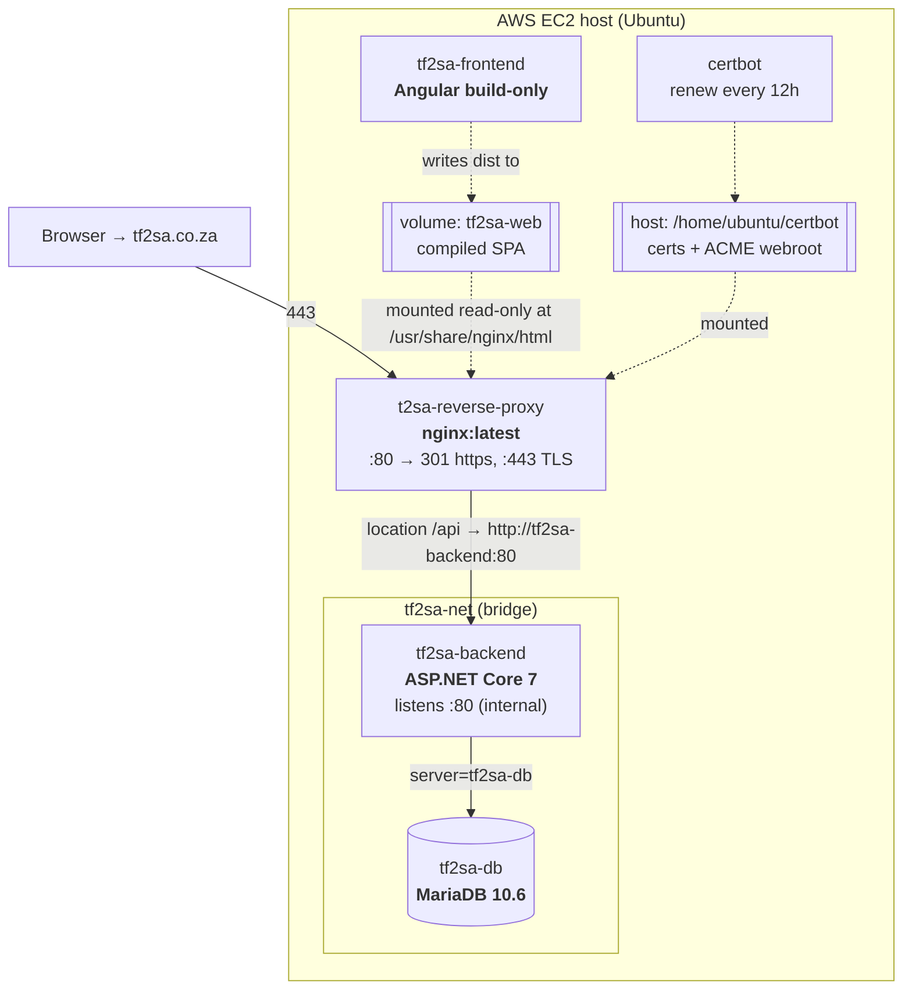
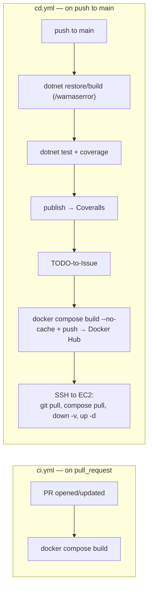

# Deployment

> How TF2SA is packaged, delivered, and run in production. For the container
> responsibilities see [overview.md](./overview.md).

## Runtime topology

Production runs on a single **AWS EC2** host (Ubuntu) as five containers defined in
[`docker-compose.yml`](../../docker-compose.yml), on a shared `tf2sa-net` bridge
network. The Angular build container and nginx communicate through a shared Docker
volume (`tf2sa-web`) rather than the network.

### Container roles

| Container | Image | Ports | Notes |
|-----------|-------|-------|-------|
| `tf2sa-db` | `danielcoetzee/tf2sa-db` (built from `scripts/mariadb/Dockerfile.tf2sa-db`) | internal | Seeds schema + procs at init. Random root password; app user from env. |
| `tf2sa-backend` | `danielcoetzee/tf2sa-backend` (`dotnet/Dockerfile.tf2sa-backend`) | internal :80 | Publishes `TF2SA.Web`; runs API + co-hosted ETL. |
| `tf2sa-frontend` | `danielcoetzee/tf2sa-frontend` (`frontend/Dockerfile.tf2sa-frontend`) | none | **Build-only** — compiles the SPA into `/out` and exits; nginx serves the volume. |
| `t2sa-reverse-proxy` | `nginx:latest` | `80`, `443` | TLS termination, static SPA, `/api` proxy. Periodically reloads for renewed certs. |
| `certbot` | `certbot/certbot:latest` | none | Renews Let's Encrypt certs on a 12h loop. |

> **Frontend is compile-then-exit.** `tf2sa-frontend` is not a running web server;
> it exists only to produce static assets into the shared `tf2sa-web` volume, which
> nginx mounts read-only. Rebuilding the frontend means rebuilding this container so
> fresh assets land in the volume.

## nginx and TLS

[`scripts/iac/nginx/nginx.conf`](../../scripts/iac/nginx/nginx.conf):

- Port 80 serves the ACME challenge (`/.well-known/acme-challenge/`) and otherwise
  `301`-redirects to `https://tf2sa.co.za`.
- Port 443 terminates TLS (certs under `/etc/nginx/ssl/live/tf2sa.co.za/`), serves
  the SPA with SPA fallback (`try_files $uri $uri/ /index.html`), and proxies
  `location /api` to `http://tf2sa-backend:80`.

The backend trusts forwarding headers (`app.UseForwardedHeaders(...)` for
`X-Forwarded-For`/`X-Forwarded-Proto`) because it sits behind this proxy.

## Configuration and secrets

All runtime configuration is injected as environment variables (see
[onboarding.md](../onboarding.md#environment-variables) for the full list and local
setup). In CI/CD these come from GitHub Actions secrets.

| Variable | Purpose |
|----------|---------|
| `TF2SA_MYSQL_HOST` / `_USR` / `_PWD` / `_DB` | Database connection (assembled in `TF2SA.Data/DependencyInjection.cs`). |
| `TF2SA_STEAM_API_KEY` | Steam Web API key for player enrichment. |

The frontend's API base URL is compiled in, not env-injected:
`frontend/src/environments/environment.ts` (`https://tf2sa.co.za/api/v1`) for
production, `environment.development.ts` (`https://localhost:5001/api/v1`) for dev.

## CI/CD pipelines (GitHub Actions)

Two workflows in `.github/workflows/`:

- **CI** (`ci.yml`) runs on every pull request and only verifies that the Docker
  images build.
- **CD** (`cd.yml`) runs on push to `main`: it builds and unit-tests the .NET
  solution (failing on warnings), publishes coverage to Coveralls, converts new
  `TODO` comments to GitHub issues, builds and pushes the three images to Docker
  Hub, then SSHes into the EC2 host and redeploys with `docker-compose pull` +
  `down -v` + `up -d`.

> **`down -v` drops volumes on each deploy.** Because MariaDB seeds its schema from
> `docker-entrypoint-initdb.d` on a fresh volume, deployment behavior around data
> persistence depends on how the DB data volume is provisioned on the host. Verify
> the host's volume/persistence setup before relying on data surviving a deploy.
> Tracked in [known-issues.md](../known-issues.md).

## Host provisioning

`scripts/iac/iac.sh` is a minimal bootstrap that installs Docker and
docker-compose on a fresh Ubuntu host. TLS material lives under
`/home/ubuntu/certbot` on the host and is bind-mounted into nginx and certbot.

## Historical note

Production previously ran on **Oracle Cloud** and was migrated to **AWS EC2**. A
leftover Oracle Cloud IP still appears in the backend CORS allowlist
(`TF2SA.Web/Program.cs`); it is harmless but noted in
[known-issues.md](../known-issues.md) for cleanup.

## When to update this document

Update this document when:

- The container topology, ports, networks, or volumes change.
- The hosting provider or host provisioning changes.
- The nginx routing/TLS setup changes.
- The CI or CD workflow steps change (build, test, publish, or deploy).
- The set of required environment variables/secrets changes (also update
  [onboarding.md](../onboarding.md)).
