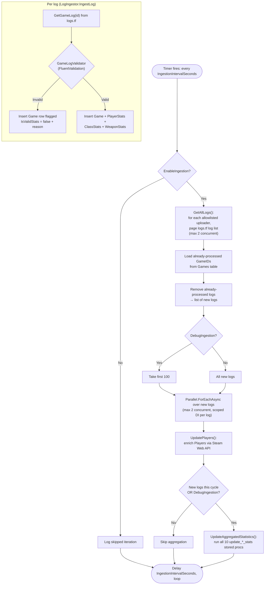

# Ingestion Pipeline (Write Path)

> The ETL pipeline that turns logs.tf match logs into the aggregated leaderboard
> tables the API serves. This is the heart of the system. For the read side see
> [request-flow.md](./request-flow.md); for the schema see
> [database.md](./database.md).

## What it does and why

logs.tf stores raw per-match logs, but they are not aggregated per player over
time or scoped to a community. The ingestion pipeline exists to:

1. Discover which logs belong to the SA community (via the curated uploader
   allowlist — [ADR 0007](../decisions/0007-curated-uploader-allowlist.md)).
2. Fetch, validate, and store the raw game data.
3. Enrich player identities from the Steam Web API.
4. Recompute the aggregated leaderboard tables via SQL stored procedures.

It runs continuously on a timer **inside the `tf2sa-backend` process** as an
ASP.NET Core `BackgroundService` — not as a separate container or cron job. See
[ADR 0006](../decisions/0006-cohosted-etl-background-service.md).

## Where it lives

| Component | File |
|-----------|------|
| Hosted service entry | `TF2SA.StatsETLService/StatsETLServiceRunner.cs` |
| Loop + orchestration | `TF2SA.StatsETLService/LogsTFIngestion/Handlers/LogsTFIngestionHandler.cs` |
| Per-log ingest | `TF2SA.StatsETLService/LogsTFIngestion/Services/LogIngestor.cs` |
| Repository writes | `TF2SA.StatsETLService/LogsTFIngestion/Services/LogIngestionRepositoryUpdater.cs` |
| Aggregation trigger | `TF2SA.StatsETLService/LogsTFIngestion/Services/StatisticsUpdater.cs` |
| Validation | `TF2SA.StatsETLService/LogsTFIngestion/Validation/*.cs` (FluentValidation) |
| logs.tf client | `TF2SA.Http/LogsTF/Service/LogsTFService.cs` |
| Steam client | `TF2SA.Http/Steam/Service/SteamService.cs` |
| Aggregation SQL | `scripts/mariadb/update_*_stats.sql` (10 stored procs) |
| Configuration | `LogsTFIngestion` + `LogsTF` sections in `appsettings.json` |

## Configuration

From `TF2SA.Web/appsettings.json` (the deployed host):

| Setting | Default | Meaning |
|---------|---------|---------|
| `LogsTFIngestion.EnableIngestion` | `true` (Web) / `false` (worker) | Master switch. When off, the loop idles and logs each skipped iteration. |
| `LogsTFIngestion.IngestionIntervalSeconds` | `3600` | Delay between ingestion cycles. |
| `LogsTFIngestion.DebugIngestion` | `false` | When true, processes only the first 100 candidate logs and forces an aggregation refresh. |
| `LogsTF.BaseUrl` | `http://logs.tf/api/v1` | logs.tf API root. |
| `LogsTF.Uploaders` | 10 Steam IDs | The curated allowlist of SA community uploaders. |
| `Constants.MAX_CONCURRENT_HTTP_THREADS` | `2` | Caps parallel HTTP calls to logs.tf (in `TF2SA.Common/Configuration/Constants.cs`). |

## End-to-end flow

## Stage detail

### 1. Discover candidate logs
`LogsTFService.GetAllLogs()` iterates the configured `Uploaders`, and for each one
pages the logs.tf `/log` endpoint (`LIMIT_MAX` per page) until all of that
uploader's logs are collected. Uploaders are fetched with up to
`MAX_CONCURRENT_HTTP_THREADS` (2) in parallel.

### 2. Filter to new logs
`LogsTFIngestionHandler.GetLogsToProcess()` loads the `GameID`s already in the
`Games` table and removes them from the candidate list, so each log is ingested at
most once. (The `Games` table doubles as the processed-log ledger — including logs
stored as invalid.)

### 3. Fetch, validate, store each log
For each new log, a **fresh DI scope** is created (so each gets its own
`DbContext`), and `LogIngestor.IngestLog()`:
- fetches the full game log from logs.tf,
- runs `GameLogValidator` (which composes `LogInfoValidator`,
  `PlayerStatsValidator`, `ClassStatsValidator`, `WeaponStatsValidator`),
- on **valid**: writes `Games`, `PlayerStats`, `ClassStats`, `WeaponStats` rows,
- on **invalid**: writes a `Games` row flagged `IsValidStats = false` with the
  validation reason, so the log is recorded and not re-fetched.

Errors are returned as `EitherStrict`/`OptionStrict` values and logged; a single
failing log does not abort the cycle.

### 4. Enrich players
`UpdatePlayers()` resolves player profile fields (name, avatars, country, profile
URL) from the Steam Web API for players seen in the ingested logs.

### 5. Recompute aggregates
If any new logs were processed (or `DebugIngestion` is on),
`StatisticsUpdater.UpdateAggregatedStatistics()` runs all ten aggregation stored
procedures via `ExecuteSqlRawAsync`, rebuilding the leaderboard tables. See
[database.md](./database.md) for what "recent" vs "all-time" mean and how the procs
work.

> **Known issue:** `StatisticsUpdater` contains copy-paste guard-clause bugs that
> can suppress or misreport some aggregation errors. Behavior of the happy path is
> unaffected. Tracked in [known-issues.md](../known-issues.md).

## Design notes

- **Idempotent by construction.** Re-running the pipeline reprocesses only logs not
  already in `Games`; aggregation procs `DELETE` then re-`INSERT` their target
  tables, so they are safe to re-run.
- **Bounded concurrency.** Both log-list fetching and per-log ingestion are capped
  at 2 concurrent operations to stay friendly to the logs.tf API.
- **Cancellation.** The loop and HTTP calls thread a `CancellationToken`. Some
  repository methods do not yet honor cancellation (noted as a TODO in code and in
  [known-issues.md](../known-issues.md)).

## When to update this document

Update this document when:

- The ingestion stages change (new/removed step, reordering, different trigger).
- The source of candidate logs changes (new provider, different filtering than the
  uploader allowlist).
- Validation rules or the raw tables written during ingestion change.
- Concurrency limits, scheduling, or the enable/debug configuration change.
- The pipeline is moved out of the backend process into its own host/container
  (which would also update [ADR 0006](../decisions/0006-cohosted-etl-background-service.md)).
