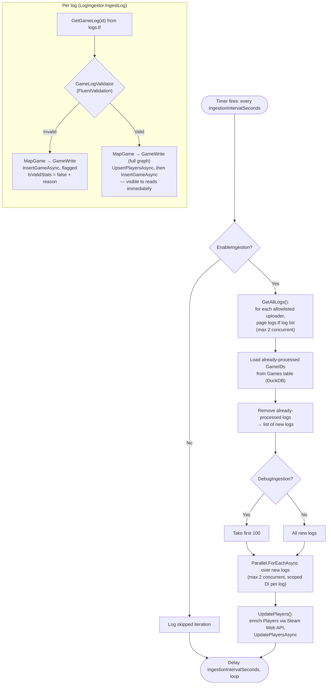

# Ingestion Pipeline (Write Path)

> The ETL pipeline that turns logs.tf match logs into the aggregated leaderboard
> tables the API serves. This is the heart of the system. For the read side see
> [request-flow.md](./request-flow.md); for the schema see
> [database.md](./database.md).

## What it does and why

logs.tf stores raw per-match logs, but they are not aggregated per player over
time or scoped to a community. The ingestion pipeline exists to:

1. Discover which logs belong to the SA community (via the curated uploader
   allowlist — [ADR 0007](../decisions/0007-curated-uploader-allowlist.md)).
2. Fetch, validate, and store the raw game data — directly in DuckDB, the only
   database ([ADR 0009](../decisions/0009-drop-mariadb.md)). A write is immediately
   visible to every read; there is no separate aggregation-refresh step anymore.
3. Enrich player identities from the Steam Web API.

It runs continuously on a timer **inside the `tf2sa-backend` process** as an
ASP.NET Core `BackgroundService` — not as a separate container or cron job. See
[ADR 0006](../decisions/0006-cohosted-etl-background-service.md).

## Where it lives

| Component | File |
|-----------|------|
| Hosted service entry | `TF2SA.StatsETLService/StatsETLServiceRunner.cs` |
| Loop + orchestration | `TF2SA.StatsETLService/LogsTFIngestion/Handlers/LogsTFIngestionHandler.cs` |
| Per-log ingest | `TF2SA.StatsETLService/LogsTFIngestion/Services/LogIngestor.cs` |
| Store writes + `GameLog` → row mapping | `TF2SA.StatsETLService/LogsTFIngestion/Services/LogIngestionRepositoryUpdater.cs` (hand-written mapping, calls `IAnalyticsStore.InsertGameAsync`/`UpsertPlayersAsync`/`UpdatePlayersAsync` directly) |
| Validation | `TF2SA.StatsETLService/LogsTFIngestion/Validation/*.cs` (FluentValidation) |
| logs.tf client | `TF2SA.Http/LogsTF/Service/LogsTFService.cs` |
| Steam client | `TF2SA.Http/Steam/Service/SteamService.cs` |
| Store | `IAnalyticsStore`/`DuckDbAnalyticsStore` — see [analytics-store.md](./analytics-store.md) |
| Configuration | `LogsTFIngestion` + `LogsTF` sections in `appsettings.json` |

## Configuration

From `TF2SA.Web/appsettings.json` (the deployed host):

| Setting | Default | Meaning |
|---------|---------|---------|
| `LogsTFIngestion.EnableIngestion` | `true` (Web) / `false` (worker) | Master switch. When off, the loop idles and logs each skipped iteration. |
| `LogsTFIngestion.IngestionIntervalSeconds` | `3600` | Delay between ingestion cycles. |
| `LogsTFIngestion.DebugIngestion` | `false` | When true, processes only the first 100 candidate logs. |
| `LogsTF.BaseUrl` | `http://logs.tf/api/v1` | logs.tf API root. |
| `LogsTF.Uploaders` | 10 Steam IDs | The curated allowlist of SA community uploaders. |
| `Constants.MAX_CONCURRENT_HTTP_THREADS` | `2` | Caps parallel HTTP calls to logs.tf (in `TF2SA.Common/Configuration/Constants.cs`). |

## End-to-end flow

## Stage detail

### 1. Discover candidate logs
`LogsTFService.GetAllLogs()` iterates the configured `Uploaders`, and for each one
pages the logs.tf `/log` endpoint (`LIMIT_MAX` per page) until all of that
uploader's logs are collected. Uploaders are fetched with up to
`MAX_CONCURRENT_HTTP_THREADS` (2) in parallel.

### 2. Filter to new logs
`LogsTFIngestionHandler.GetLogsToProcess()` loads the `GameID`s already in the
`Games` table and removes them from the candidate list, so each log is ingested at
most once. (The `Games` table doubles as the processed-log ledger — including logs
stored as invalid.)

### 3. Fetch, validate, store each log
For each new log, a **fresh DI scope** is created, and `LogIngestor.IngestLog()`:
- fetches the full game log from logs.tf,
- runs `GameLogValidator` (which composes `LogInfoValidator`,
  `PlayerStatsValidator`, `ClassStatsValidator`, `WeaponStatsValidator`),
- on **valid**: `LogIngestionRepositoryUpdater` hand-maps the `GameLog` into a
  `GameWrite` graph (`Game` → `PlayerStats` → `ClassStats` → `WeaponStats`), upserts
  the players it references, then calls `IAnalyticsStore.InsertGameAsync` — one
  DuckDB transaction, rolled back whole on failure,
- on **invalid**: maps and inserts a `Game` row flagged `IsValidStats = false` with
  the validation reason, so the log is recorded and not re-fetched.

Every write is immediately visible to reads — there is no separate table it lands in
first. Errors are returned as `EitherStrict`/`OptionStrict` values and logged; a
single failing log does not abort the cycle.

### 4. Enrich players
`UpdatePlayers()` resolves player profile fields (name, avatars, country, profile
URL) from the Steam Web API for every player already in the `Players` table, then
calls `IAnalyticsStore.UpdatePlayersAsync`.

> **Historical note:** ingestion used to end with a step that refreshed a derived
> DuckDB fact table from MariaDB's raw tables, and before that, ran ten MariaDB
> aggregation stored procedures to rebuild 10 pre-computed leaderboard tables
> ([ADR 0005](../decisions/0005-sql-stored-procedures-for-aggregation.md),
> [ADR 0008](../decisions/0008-duckdb-analytics-read-layer.md), both superseded).
> Neither exists anymore — since [ADR 0009](../decisions/0009-drop-mariadb.md),
> ingestion writes directly into the same tables every query reads, so there is
> nothing left to refresh. `StatisticsUpdater`, the class that used to trigger the
> refresh (and once carried copy-paste guard-clause bugs around the 10 stored-proc
> calls it originally wrapped), is deleted.

## Design notes

- **Idempotent by construction.** Re-running the pipeline reprocesses only logs not
  already in `Games` — that dedupe check is what stops a log from being ingested
  twice, since there's no longer a separate rebuild step to fall back on for
  correctness.
- **Bounded concurrency.** Both log-list fetching and per-log ingestion are capped
  at 2 concurrent operations to stay friendly to the logs.tf API.
- **Cancellation.** The loop and HTTP calls thread a `CancellationToken`. Some
  repository methods do not yet honor cancellation (noted as a TODO in code and in
  [known-issues.md](../known-issues.md)).

## When to update this document

Update this document when:

- The ingestion stages change (new/removed step, reordering, different trigger).
- The source of candidate logs changes (new provider, different filtering than the
  uploader allowlist).
- Validation rules or the raw tables written during ingestion change.
- The write path changes (new insert/update method, different transaction shape);
  also update [analytics-store.md](./analytics-store.md).
- Concurrency limits, scheduling, or the enable/debug configuration change.
- The pipeline is moved out of the backend process into its own host/container
  (which would also update [ADR 0006](../decisions/0006-cohosted-etl-background-service.md)).
