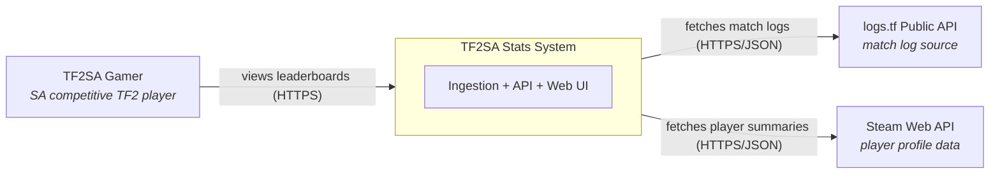
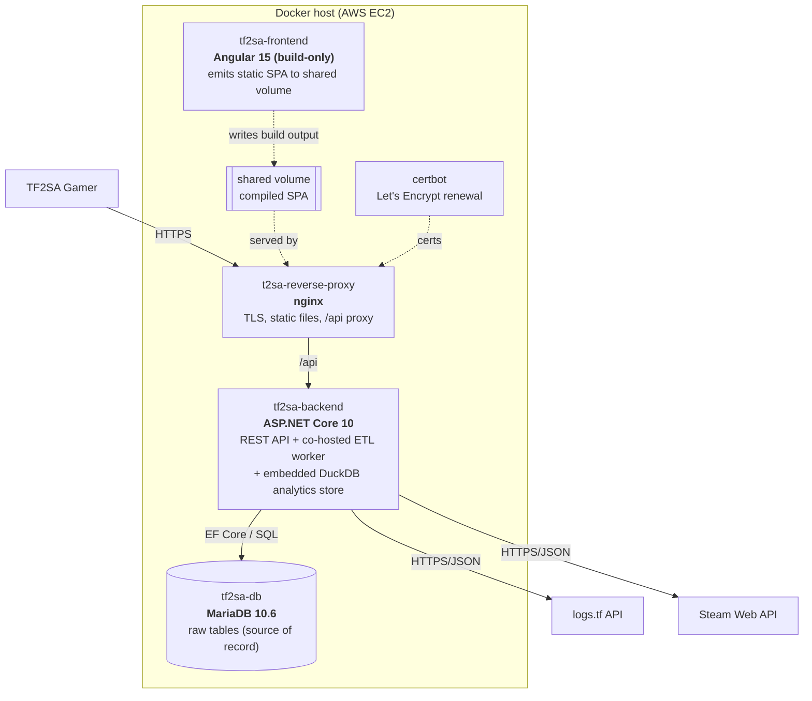
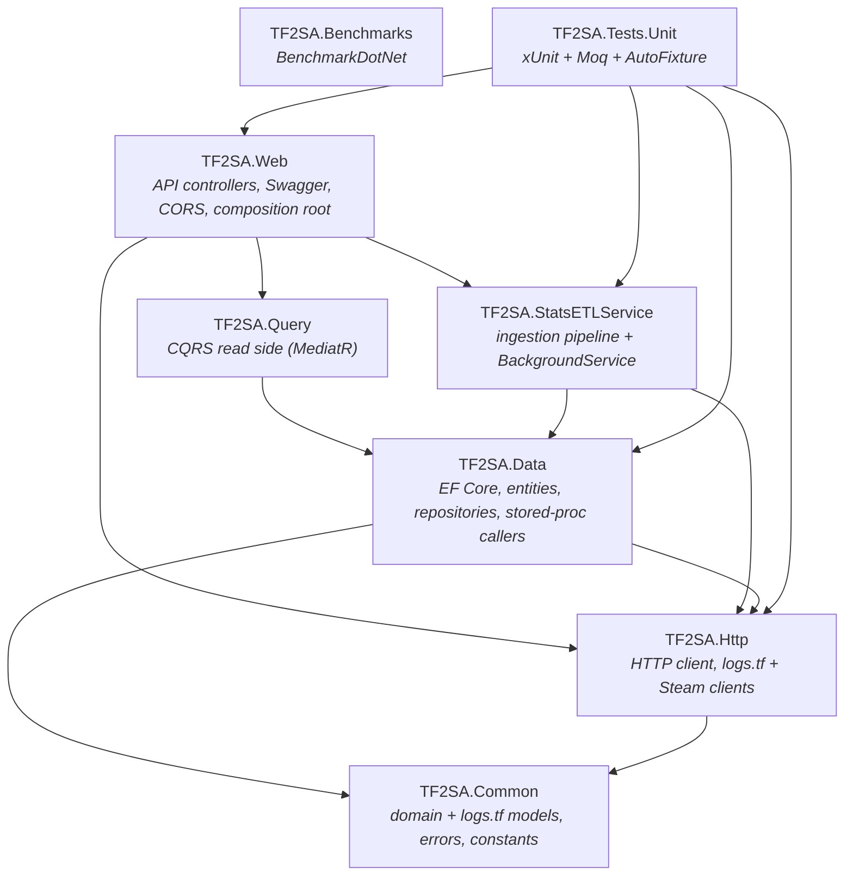

# Architecture Overview

> **Canonical technical reference for TF2SA.** Start here, then drill into the
> topic-specific documents linked below. The `README.md` summarizes this file;
> this file is the source of truth for the system's shape and rationale.

## What TF2SA is

TF2SA (Team Fortress 2 — South Africa) is a **player-performance statistics
platform** for the South African competitive TF2 community, served at
`tf2sa.co.za`. It periodically ingests match logs from the public
[logs.tf](https://logs.tf) API, stores them in MariaDB, aggregates per-class and
overall leaderboards, enriches player identities from the Steam Web API, and
presents ranked leaderboards through an Angular single-page application.

## Why it exists

Competitive TF2 games upload detailed per-match logs to logs.tf, but that data is
not aggregated per player, over time, for a specific community. TF2SA curates logs
from a **fixed allowlist of South African community uploaders** (see
[ADR 0007](../decisions/0007-curated-uploader-allowlist.md)), computes rolling
**"recent" (last 365 days)** and **"all-time"** leaderboards per class, and makes
individual and comparative performance legible to players.

## System context (C4 level 1)

A richer C4 model (context, container, and component views) is maintained as
Structurizr DSL in [`docs/structurizr/workspace.dsl`](../structurizr/workspace.dsl).
The Mermaid diagrams in this folder are the quick-reference companions to it; keep
the two in sync when the high-level structure changes.

## Container view (C4 level 2)

The system runs as five containers orchestrated by
[`docker-compose.yml`](../../docker-compose.yml). See
[deployment.md](./deployment.md) for the runtime and networking detail.

> **Key non-obvious fact:** the ETL ingestion worker is **not** a separate
> container. It runs as an ASP.NET Core `BackgroundService` **inside the
> `tf2sa-backend` process**, alongside the REST API. See
> [ADR 0006](../decisions/0006-cohosted-etl-background-service.md). The **DuckDB
> analytics store** is likewise **embedded** in that same process (a library, not a
> service — no container of its own); see
> [ADR 0008](../decisions/0008-duckdb-analytics-read-layer.md) and
> [analytics-store.md](./analytics-store.md).

## The two data paths

TF2SA has a clear **write path** (ingestion) and **read path** (serving), which
meet only at the database.

| Path | Trigger | Flow | Deep dive |
|------|---------|------|-----------|
| **Write (ingestion)** | Timer inside backend (`IngestionIntervalSeconds`, default 3600s) | logs.tf → validate → insert raw rows into MariaDB → refresh the DuckDB analytics fact table | [ingestion-pipeline.md](./ingestion-pipeline.md) |
| **Read (serving)** | User HTTP request | Angular → nginx → controller → MediatR query → repository → parametrized aggregation over the DuckDB analytics store | [request-flow.md](./request-flow.md) |

The two stores have distinct roles: **MariaDB** is the row-oriented **system of
record** for raw ingested data; **DuckDB** is a **derived, columnar analytics cache**
that serves leaderboards by aggregating on the fly ([analytics-store.md](./analytics-store.md)).

## .NET solution structure

The backend is a `net10.0` solution ([`dotnet/dotnet.sln`](../../dotnet/dotnet.sln))
of eight projects in a strict layered dependency graph. Dependencies point
inward/downward only.

| Project | Responsibility |
|---------|----------------|
| `TF2SA.Common` | Domain models, logs.tf response models (`GameLogModel`, `LogListModel`), `Player`/class stat domains, constants (`ClassId`, `TeamId`), `Error` base type. References SteamKit2. |
| `TF2SA.Http` | HTTP client abstraction (`IHttpClient`/`TF2SAHttpClient`), JSON serialization, typed clients for logs.tf (`LogsTFService`) and Steam (`SteamService`). |
| `TF2SA.Data` | EF Core `DbContext` for the raw tables (scaffolded from the live DB — see [ADR 0004](../decisions/0004-database-first-ef-scaffolding.md)), entities, repositories, AutoMapper profiles (Pomelo MySQL provider), plus the DuckDB-backed analytics repository and fact-table refresh ([ADR 0008](../decisions/0008-duckdb-analytics-read-layer.md)). |
| `TF2SA.Query` | Read side. One MediatR query + handler per leaderboard (class × recent/all-time) plus players. See [ADR 0003](../decisions/0003-cqrs-read-side-with-mediatr.md). |
| `TF2SA.StatsETLService` | The ingestion pipeline (fetch → validate → insert → aggregate) and the `StatsETLServiceRunner` hosted service. Also contains an **unused** standalone Worker `Program.cs`. |
| `TF2SA.Web` | Versioned API controllers (`v1`), Swagger, CORS, forwarded-headers config. Composition root that wires ETL + queries and is the deployed entrypoint. |
| `TF2SA.Benchmarks` | BenchmarkDotNet micro-benchmarks (e.g. player model). |
| `TF2SA.Tests.Unit` | xUnit unit tests with Moq and AutoFixture; coverage via coverlet → Coveralls. |

## Technology stack and rationale

| Concern | Choice | Notes |
|---------|--------|-------|
| Backend runtime | .NET 10 (LTS) / ASP.NET Core | Single process serves API + hosts ETL. Upgraded from the EOL .NET 7 on 2026-07-10. |
| ORM / DB access (raw) | EF Core 9 + Pomelo MySQL 9 | Database-first scaffolding of the raw tables; the DB schema is the source of truth ([ADR 0004](../decisions/0004-database-first-ef-scaffolding.md)). EF Core is on 9 (not 10) because that is Pomelo's latest provider. |
| Analytics / aggregation | Embedded **DuckDB** (columnar) | Leaderboards are aggregated on the fly from a derived fact table, in-process — no separate service ([ADR 0008](../decisions/0008-duckdb-analytics-read-layer.md), [analytics-store.md](./analytics-store.md)). Replaced MariaDB stored procedures ([ADR 0005](../decisions/0005-sql-stored-procedures-for-aggregation.md), superseded). |
| Read side | MediatR (CQRS-lite) | Thin controllers delegate to query handlers ([ADR 0003](../decisions/0003-cqrs-read-side-with-mediatr.md)). |
| Error handling | `csharp-monad` (`EitherStrict`/`OptionStrict`) | Errors are returned as values across boundaries, not thrown ([ADR 0002](../decisions/0002-functional-error-handling-with-monads.md)). |
| Validation | FluentValidation | Applied to logs.tf game logs during ingestion. |
| Mapping | AutoMapper | Entities ↔ domain ↔ HTTP result models. |
| External data | logs.tf API, Steam Web API | Match logs and player profile enrichment. |
| Frontend | Angular 15 + Angular Material | Atomic-design components; RxJS server-driven tables. **Angular 15 is end-of-life** — see [known-issues.md](../known-issues.md). |
| Database (system of record) | MariaDB 10.6 | Raw-table schema seeded at container init. |
| Reverse proxy / TLS | nginx + certbot (Let's Encrypt) | Serves SPA static files, proxies `/api`. |
| Packaging | Docker + Docker Compose | Five-container topology. |
| CI/CD | GitHub Actions | CI builds images on PR; CD builds/tests/pushes and deploys to EC2 over SSH. |

## Conventions worth knowing before you touch the code

- **Errors are values.** Public methods return `EitherStrict<Error, T>` (success or
  error) or `OptionStrict<Error>` (error or nothing). Check `IsLeft`/`HasValue`
  before using the result. Don't reintroduce exception-based control flow across
  layer boundaries.
- **The database schema is authoritative.** Entities in `TF2SA.Data/Entities/MariaDb`
  are **generated** by `scaffold.sh` from the live DB. Change SQL first, then
  re-scaffold — hand-edits get overwritten. See [database.md](./database.md).
- **Leaderboard math lives in the analytics store.** To change how a stat is
  computed — or the recent-window length or the games threshold — edit the DuckDB
  aggregation query, not the schema. There are no per-class/per-window tables or
  stored procedures to keep in sync ([analytics-store.md](./analytics-store.md)).
- **Read side is CQRS.** Adding an endpoint usually means a new MediatR query +
  handler + result model + a thin controller action.
- **Formatting is enforced.** C# uses [CSharpier](../../dotnet/.csharpierrc) (tabs,
  width 80); the frontend uses Prettier. CI builds with `/warnaserror`.

## When to update this document

Update this overview when any of the following change:

- A project is added to or removed from the solution, or the dependency graph
  between projects changes.
- A container is added/removed, or the split of responsibilities between containers
  changes (e.g. the ETL worker is extracted into its own container).
- A core cross-cutting convention changes (error handling, CQRS, database-first).
- A major technology or its version is swapped (e.g. .NET or Angular upgrade).

For deeper changes, update the corresponding topic document as well, and keep the
Structurizr model in `docs/structurizr/` consistent with the diagrams here.
