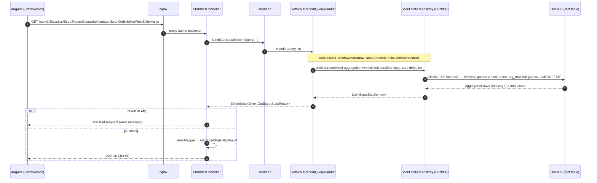

# Request Flow (Read Path)

> How a user request for leaderboard/player data travels from the browser to the
> database and back. For the write side see
> [ingestion-pipeline.md](./ingestion-pipeline.md).

## Overview

The read path is a thin, layered CQRS-lite pipeline. Controllers do no business
logic — they translate HTTP into a MediatR query, and translate the query result
into an HTTP response. Serving a leaderboard is a **parametrized aggregation** run
on the fly in the embedded **DuckDB analytics store** (columnar, fast enough to
aggregate per request — see [analytics-store.md](./analytics-store.md)); the
class, time-window ("recent" vs "all-time"), and min-games threshold are query
parameters. The CQRS shape and the HTTP/JSON contract are unchanged from when this
read from pre-aggregated MariaDB tables — only the data-access layer moved.

During the migration this is **config-gated**: each query handler reads from DuckDB
when the analytics store is enabled (`TF2SA_ANALYTICS_ENABLED`), and otherwise falls
back to the EF-over-pre-agg-tables path. Phase 3 removes the fallback, the pre-agg
tables, and the stored procs.

```mermaid
flowchart LR
    browser["Angular SPA<br/><i>StatsService / PlayersService</i>"]
    nginx["nginx<br/><i>reverse proxy</i>"]
    controller["Controller<br/><i>StatisticsController / PlayersController</i>"]
    mediator["MediatR"]
    handler["Query Handler<br/><i>Get*QueryHandler</i>"]
    repo["Stats Repository<br/><i>DuckDB-backed</i> / Players Repository <i>(EF)</i>"]
    duck[("DuckDB<br/>analytics fact table")]

    browser -->|"GET /api/v1/... (HTTPS/JSON)"| nginx
    nginx -->|"/api → backend:80"| controller
    controller -->|"Send(query)"| mediator
    mediator --> handler
    handler --> repo
    repo -->|"parametrized aggregation SQL"| duck
    duck -.->|rows| repo
    repo -.->|domain models| handler
    handler -.-> mediator
    mediator -.-> controller
    controller -.->|AutoMapper → HTTP result| browser
```

## Sequence: fetch Scout "recent" leaderboard

## Layer responsibilities

| Layer | Type(s) | Responsibility |
|-------|---------|----------------|
| Browser | `StatsService`, `PlayersService` (Angular) | Build query params (page size, offset, sort, filter, stat period), call the API, feed Material tables. |
| Reverse proxy | nginx (`scripts/iac/nginx/nginx.conf`) | Serve SPA static files; proxy `/api` to `tf2sa-backend:80`. |
| Controller | `StatisticsController.*`, `PlayersController` | Bind query-string params (with defaults), send a MediatR query, map the result to an HTTP result model, return `200` or `400`. No business logic. |
| Mediator | MediatR | Dispatch each query to its single handler. |
| Query handler | `Get*QueryHandler` | Pass class/period/threshold + paging/sort/filter to the repository, project rows to domain models, wrap in `EitherStrict<Error, ...>`. |
| Repository (stats) | DuckDB-backed stats repository | Build the **parametrized aggregation SQL**; provide **whitelisted** sort/filter (request keys → fixed column names, safe defaults); never interpolate raw input. |
| Repository (players) | `PlayersRepository` | The `/Players` directory still reads the raw `Players` table via EF Core + Pomelo. |
| Data (stats) | Embedded DuckDB | Columnar, vectorized aggregation over the fact table, per request. See [analytics-store.md](./analytics-store.md). |

## API surface

Routes are versioned under `v1` and proxied beneath `/api` (nginx) with an
additional `/api` path base configured in the app (`app.UsePathBase("/api")`), so
the browser-visible prefix is `/api/v1`.

The endpoint URLs are unchanged; the `Recent` / `AllTime` suffix now selects a
**time-window parameter** on the same fact-table query, not a distinct table.

| Endpoint (browser-visible) | Controller action | Backing query |
|----------------------------|-------------------|---------------|
| `GET /api/v1/Statistics/OverallRecent` / `OverallAllTime` | `StatisticsController.Overall` | fact table, all classes (with per-class carve-outs), window = recent / all-time |
| `GET /api/v1/Statistics/ScoutRecent` / `ScoutAllTime` | `StatisticsController.Scout` | fact table, `ClassID = 1`, window = recent / all-time |
| `GET /api/v1/Statistics/SoldierRecent` / `SoldierAllTime` | `StatisticsController.Soldier` | fact table, `ClassID = 2`, window = recent / all-time |
| `GET /api/v1/Statistics/DemomanRecent` / `DemomanAllTime` | `StatisticsController.Demoman` | fact table, `ClassID = 4`, window = recent / all-time |
| `GET /api/v1/Statistics/MedicRecent` / `MedicAllTime` | `StatisticsController.Medic` | fact table, `ClassID = 7`, window = recent / all-time |
| `GET /api/v1/Players` | `PlayersController` | raw `Players` table (EF Core) |

`StatisticsController` is a **partial class** split across one file per class
(`StatisticsController.Scout.cs`, `.Soldier.cs`, etc.), sharing the constructor and
`[Route("v1/[controller]")]` defined in `StatisticsController.cs`. Swagger UI is
available in all environments (`app.UseSwagger()` / `UseSwaggerUI()`).

## Common query parameters

Statistics endpoints accept: `count` (page size), `offset`, `sort`, `sortOrder`
(`asc`/`desc`), `filterField`, `filterValue`. Defaults live on the controller
actions (e.g. `count=13`, `sort=averageDpm`, `sortOrder=desc`). Invalid `sort` or
`filterField` values fall back to safe defaults in the stats repository rather than
erroring, and only whitelisted properties are sortable/filterable — a small but
important guard against arbitrary column access (and, now that queries are built as
SQL, against injection).

Because aggregation is now dynamic, the **time-window** (recent vs all-time) and the
**min-games threshold** are parameters rather than fixed schema. Today the URL suffix
still encodes the window; exposing an arbitrary window or threshold as an explicit
query parameter is a natural, non-breaking extension.

## When to update this document

Update this document when:

- A new read endpoint or controller is added, or routing/versioning changes.
- The query pipeline changes (e.g. sorting/filtering/paging semantics, or a new
  layer is introduced between controller and repository).
- The mapping strategy between row → domain → HTTP result changes.
- The API path base or nginx proxy path changes.
- The stats read layer moves off DuckDB, or the aggregation query/parameter model
  changes (also update [analytics-store.md](./analytics-store.md)).
