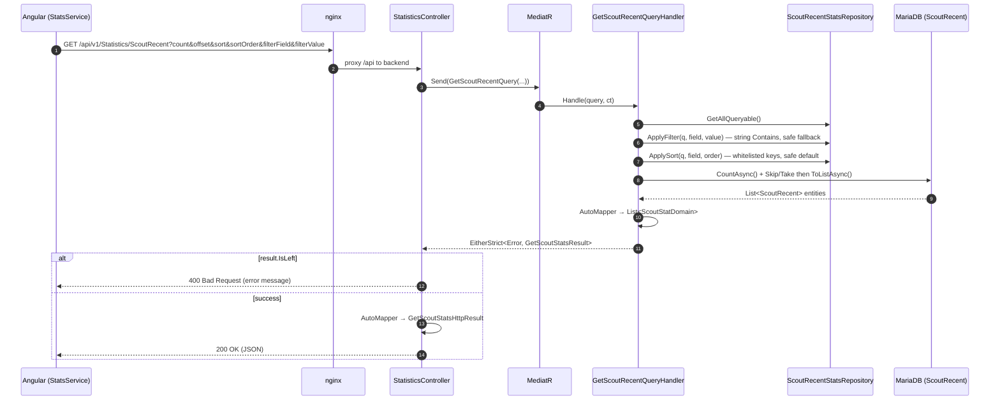

# Request Flow (Read Path)

> How a user request for leaderboard/player data travels from the browser to the
> database and back. For the write side see
> [ingestion-pipeline.md](./ingestion-pipeline.md).

## Overview

The read path is a thin, layered CQRS-lite pipeline. Controllers do no business
logic — they translate HTTP into a MediatR query, and translate the query result
into an HTTP response. All aggregation has already happened during ingestion, so
serving a leaderboard is essentially a paged, sorted, filtered read of a
pre-computed table.

```mermaid
flowchart LR
    browser["Angular SPA<br/><i>StatsService / PlayersService</i>"]
    nginx["nginx<br/><i>reverse proxy</i>"]
    controller["Controller<br/><i>StatisticsController / PlayersController</i>"]
    mediator["MediatR"]
    handler["Query Handler<br/><i>Get*QueryHandler</i>"]
    repo["Stats/Players Repository"]
    ef["EF Core (Pomelo)"]
    db[("MariaDB<br/>aggregated tables")]

    browser -->|"GET /api/v1/... (HTTPS/JSON)"| nginx
    nginx -->|"/api → backend:80"| controller
    controller -->|Send(query)| mediator
    mediator --> handler
    handler --> repo
    repo --> ef
    ef -->|SQL SELECT| db
    db -.->|rows| ef
    ef -.->|entities| repo
    repo -.->|entities| handler
    handler -.->|AutoMapper → domain| mediator
    mediator -.-> controller
    controller -.->|AutoMapper → HTTP result| browser
```

## Sequence: fetch Scout "recent" leaderboard



## Layer responsibilities

| Layer | Type(s) | Responsibility |
|-------|---------|----------------|
| Browser | `StatsService`, `PlayersService` (Angular) | Build query params (page size, offset, sort, filter, stat period), call the API, feed Material tables. |
| Reverse proxy | nginx (`scripts/iac/nginx/nginx.conf`) | Serve SPA static files; proxy `/api` to `tf2sa-backend:80`. |
| Controller | `StatisticsController.*`, `PlayersController` | Bind query-string params (with defaults), send a MediatR query, map the result to an HTTP result model, return `200` or `400`. No business logic. |
| Mediator | MediatR | Dispatch each query to its single handler. |
| Query handler | `Get*QueryHandler` | Build the queryable, apply filter + sort + paging, project entities to domain models, wrap in `EitherStrict<Error, ...>`. |
| Repository | `StatsRepository<TEntity>`, `PlayersRepository` | Expose `IQueryable`, and provide **whitelisted** sort/filter via `PropertyKeySelectors` and safe defaults. |
| Data | EF Core + Pomelo | Translate LINQ to SQL against the aggregated tables. |

## API surface

Routes are versioned under `v1` and proxied beneath `/api` (nginx) with an
additional `/api` path base configured in the app (`app.UsePathBase("/api")`), so
the browser-visible prefix is `/api/v1`.

| Endpoint (browser-visible) | Controller action | Backing table |
|----------------------------|-------------------|---------------|
| `GET /api/v1/Statistics/OverallRecent` / `OverallAllTime` | `StatisticsController.Overall` | `OverallStatsRecent` / `OverallStatsAllTime` |
| `GET /api/v1/Statistics/ScoutRecent` / `ScoutAllTime` | `StatisticsController.Scout` | `ScoutRecent` / `ScoutAllTime` |
| `GET /api/v1/Statistics/SoldierRecent` / `SoldierAllTime` | `StatisticsController.Soldier` | `SoldierRecent` / `SoldierAllTime` |
| `GET /api/v1/Statistics/DemomanRecent` / `DemomanAllTime` | `StatisticsController.Demoman` | `DemomanRecent` / `DemomanAllTime` |
| `GET /api/v1/Statistics/MedicRecent` / `MedicAllTime` | `StatisticsController.Medic` | `MedicRecent` / `MedicAllTime` |
| `GET /api/v1/Players` | `PlayersController` | `Players` |

`StatisticsController` is a **partial class** split across one file per class
(`StatisticsController.Scout.cs`, `.Soldier.cs`, etc.), sharing the constructor and
`[Route("v1/[controller]")]` defined in `StatisticsController.cs`. Swagger UI is
available in all environments (`app.UseSwagger()` / `UseSwaggerUI()`).

## Common query parameters

Statistics endpoints accept: `count` (page size), `offset`, `sort`, `sortOrder`
(`asc`/`desc`), `filterField`, `filterValue`. Defaults live on the controller
actions (e.g. `count=13`, `sort=averageDpm`, `sortOrder=desc`). Invalid `sort` or
`filterField` values fall back to safe defaults in `StatsRepository` rather than
erroring, and only whitelisted properties are sortable/filterable — a small but
important guard against arbitrary column access.

## When to update this document

Update this document when:

- A new read endpoint or controller is added, or routing/versioning changes.
- The query pipeline changes (e.g. sorting/filtering/paging semantics, or a new
  layer is introduced between controller and repository).
- The mapping strategy between entity → domain → HTTP result changes.
- The API path base or nginx proxy path changes.
